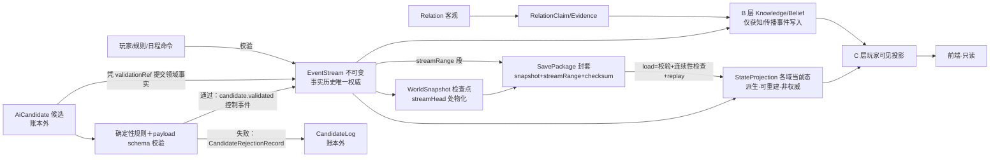
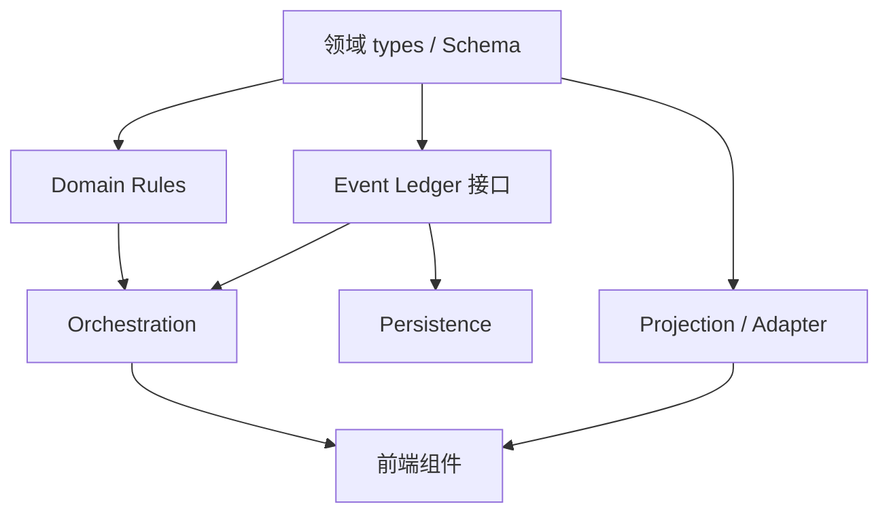
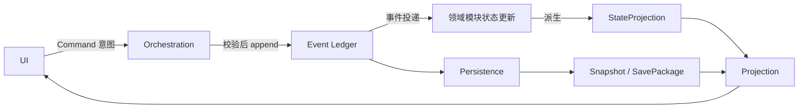

# 正式世界领域模型与边界契约草案 v0.1

> **项目：**《观远》古代官员与官场社会模拟器
> **文档状态：** 候选草案 / **02-R6 施工切片对齐版 · 待负责人冻结 · 未冻结**
> **基线：** `feat/g1-engine@93b984e`（v0.16 总纲已合入）；R4 修订基线 `b874dd9`
> **权威关系：** 服从根目录《设计总纲.md》v0.16 与两份专项规范；**v0.16 是设计权威，本草案不得反向修改**；冲突以总纲为准。
> **性质：** 只读审计 + 设计契约。**不含任何运行时代码改动**；Schema 为草案文本，不写入 app/；无法定稿的类型显式标待决，不伪装完整可编译。

---

## 1. 设计目标与适用范围

### 1.1 目标

为正式世界运行时（W1 人物领域 → W2 生命周期 → W3 事件账本 → W4 存档迁移 → W5 G1 适配）提供领域模型与边界契约；02-R5 在保留 R1–R4 全部裁决的基础上，闭合四项剩余边界：Event.kind 与 payload 的真正判别联合及来源元数据联合、全量/增量存档的可恢复连续区间、Asset.owner 的唯一主体派生条件、AI 候选验证事件的可追溯凭证。

### 1.2 适用范围

适用：正式世界运行时领域层、W1–W5 契约依据。不适用：M1 预览切片运行逻辑（W5 适配）、前端重构、v0.16 冻结原则修改。七人河工＝中期任官压力测试夹具，非正式开局人物库。

### 1.3 核心裁决继承（v0.16，R3 重申保留）

1. Person 跨场景/跨时间/跨人生阶段持续存在；死亡不删除历史。
2. 年龄＝derive(worldTime, birth)，禁止存储矛盾年龄字段。
3. Identity / Office / Role / Status 不混淆；Office 独立于人物、岗位可空缺、职权随岗位。
4. Relation 有向、多重、可不对称；债务/职位/组织成员/共同知情不自动推导私人信任。
5. A 客观事实 / B 人物认知 / C 玩家可见严格隔离；Projection 不得写入事实。
6. AI 只生成候选；**未经确定性规则校验不得成为事实**（R3 强化为提交不变量，§11.4）。
7. EventStream 是事实历史唯一权威；快照/投影/存档包皆派生。
8. 世界不围着玩家转；NPC 按 L0–L3 分层。
9. 未决设计标待裁决，不得擅自冻结。
10. **null / 缺省 / unknown / not-generated / n/a 不混用**（R3 全 Schema 统一于 Field 判别联合）。

## 2. 现有代码审计结果（基线 93b984e，逐文件实读）

### 2.1 领域对象真实映射表

| 对象 | 当前定义 | 使用位置 | 所有者 | 持久化 | 事件驱动 | 重复 | 事实/认知混合 | 复用结论 |
|---|---|---|---|---|---|---|---|---|
| Person | types.ts:72-99 | data.ts:10 静态七人；各面板只读 | data.ts（运行时零写入） | 否 | 否 | 无 | tokens/claim/questions 混合 | 适配领域 Person；静态降夹具 |
| RelationTokens | types.ts:28-32 | DebtLedger/PersonArchive 只读 | data.ts | 否 | 否（无写入路径） | 与 Debt/Hook 三合一 | 混合 | 废弃权威；拆 Relation/Debt/Hook |
| Goal | types.ts:64-70 | data.goals＋state.goalId | data.ts＋state | goalId 入存档 | 否 | 与 NPC Goal 同名异义 | 玩家≠人物 | PlayerGoal 保留；NPC Goal 新建 |
| WorldEvent / GeneratedEvent | schedule.ts:10-20 / narrative/types.ts:80-87 | engine/commands/narrative | schedule＋state＋叙事档 | 部分 | 部分 | 继承重叠 | present 字符串 | 账本化 Event；Generated 降 AiCandidate |
| Clue / Comparison | types.ts:37-43/56-62 | state；EvidenceBoard | useGame | 入存档 | 是 | 无 | 玩家单层 | C 层调查产物 |
| RevealDepth | types.ts:9＋people.ts:41 | 认知闸 | 纯投影 | 否 | 间接 | 无 | 仅玩家层 | C 层谓词重基 |
| RiverPlan | types.ts:45-54 | state.plan | useGame | 入存档 | 是 | 无 | 玩家委托 | Task/Commission（W3/W5） |
| Body/Mind/Capability/Identity/Relation/Debt/Secret/Hook/Knowledge/Belief/Location/Schedule/Asset/Org/Membership | 全库无定义 | — | — | — | — | — | — | 新建（W1/W2/W3） |
| LifeHistory | 无；milestones＋sharedHistoryOf | PersonArchive/Epilogue | data＋投影 | 否 | 否 | 无 | 混合 | 事件引用序（W2） |
| Office/Authorization | 无；power.ts:76 投影 | PowerLedger | 纯投影 | 否 | 间接 | 无 | 无官职实体 | 新建 Office（客观 held/vacant） |

### 2.2 写入路径与权威现状

useGame 13 处 setState＋save.v1 无版本→前端为权威（违原则 9，W5 退壳）；commands 校验→成本→原子→rejected 模式保留（W3 接 Ledger）；handledEvents 仅 id 列表＋pendingEvent 单槽→W3 账本化；四持久化 key；tokens 无运行时写入、claim 静态→W1 迁 Knowledge。

### 2.3 重复与冲突结论

Goal 同名异义禁合并；RelationTokens 三合一拆分；WorldEvent/GeneratedEvent 继承重叠→统一 Event＋AiCandidate 来源语义；Clue/RevealDepth 单层→B 层新建；无第二套 Person/Event/Relation；本草案不建平行系统。

## 3. 领域实体总表

### 3.1 实体与权威

| 实体 | 层 | 权威所有者 | 变更途径 | 持久化 | M1 |
|---|---|---|---|---|---|
| Person | 核心 | Person 模块 | 仅 Event | 是 | 骨架＋夹具 |
| IdentityAssignment | 身份 | Identity 模块 | 仅 Event | 是 | 三轴骨架 |
| Role / Status | 身份 | 投影 | 仅 Event 间接 | 投影 | 当前态 |
| Office / Authorization | 身份 | Office 模块 | 仅 Event | 是 | 夹具官职·客观 held/vacant |
| Relation | 关系 | Relation 模块 | 仅 Event | 是 | 类型化骨架 |
| RelationClaim / RelationEvidence | 关系确认 | Relation 模块 | 仅 Event | 是 | 骨架 |
| Organization / Membership | 关系 | Organization 模块 | 仅 Event | 是 | 骨架 |
| Location | 位置 | Location 模块 | 仅 Event | 是 | 场景级·事实/认知分离 |
| KnowledgeEntry / Belief / Message | 认知 | Knowledge 模块 | 仅获知/传播事件 | 是 | B 层骨架 |
| Goal / PlayerGoal | 目标 | Goal 模块 | 仅 Event | 是 | 骨架 |
| ScheduleScope / ScheduleEntry | 日程 | Schedule 模块 | 仅 Event | 是 | 一对多·不变量 |
| Asset / Debt | 经济 | Economy 模块 | 仅 Event | 是 | 四权·多主体 |
| Body / Mind | 生命 | Life 模块（两 scope） | 仅 Event（W2） | 是 | 留接口 |
| Capability | 能力 | Person 模块 | 仅 Event（W2） | 是 | 夹具五维 |
| LifeHistory | 生命 | Life 模块 | 追加不覆盖 | 是 | W2 |
| AiCandidate | 候选 | Narrative（账本外） | 校验前不入账本 | 叙事档 | 候选边界 |
| EventEnvelope / Event / EventRegistry | 事实 | Event Ledger | 唯一写入 | 是 | W3 |
| WorldSnapshot / SavePackage | 存储派生 | Persistence | 序列化/迁移 | 是 | W4 |
| Projection / G1 Adapter | 投影 | Adapter | 只读零写入 | 否 | W5 |

### 3.2 v0.16 全人物状态域映射表

| v0.16 状态域 | 领域实体/模块 | 阶段 | M1 | 现 G1 对应 |
|---|---|---|---|---|
| 身体 | Body（Life·物理 scope） | W2 | 留接口 | 无 |
| 心理 | Mind（Life·心理 scope，独立 Body） | W2 | 留接口 | Person.fear 静态 |
| 能力 | Capability（Person 模块） | W1/W2 | 夹具五维 | Capability/needs |
| 教育知识 | Knowledge＋Identity(social) | W1/W3 | 骨架 | 无 |
| 身份资格 | IdentityAssignment＋Office | W1 | 夹具 | seal/rank/origin |
| 人生阶段 | LifeState＋WorldTime 推导 | W2 | 留接口 | 无 |
| 家庭亲属 | Relation(kinship)＋Identity(family) | W1/W2 | 骨架 | 无 |
| 关系 | Relation＋Claim/Evidence＋KnowledgeEntry | W1/W3 | 骨架 | tokens 静态 |
| 组织 | Organization/Membership | W1 | 骨架 | 无 |
| 经济 | Asset(四权多主体)/Debt | W1/W3 | 骨架 | privateFunds/ledgerRows |
| 认知 | Knowledge/Belief/Message | W1/W3 | B 骨架 | Clue/RevealDepth |
| 目标计划 | Goal/PlayerGoal(Field) | W1 | 骨架 | goals＋goalId |
| 日程位置 | ScheduleScope/Entry(一对多)/Location | W1/W2 | 场景级 | presence/fixedEvents |
| 名声评价 | Relation 强度投影＋echoes | W3/W5 | 投影 | reputation/echoesOf |
| 法律风险 | Office/Authorization＋越权 Event | W3 | 投影 | overreachOf |
| 物品生活 | Asset(kind=物品) | W2+ | 留接口 | 无 |

## 4. Person 核心模型

```ts
type PersonId = string & { readonly __brand: 'PersonId' }
interface Person {
  id: PersonId
  displayName: string
  birth: Field<WorldTime>
  lifeState: 'alive' | 'dead'
  archiveState: 'active' | 'archived'      // 与 lifeState 独立
  death: Field<DeathRecord>                // 不变量见 §4.1
  capability: CapabilityRef
  stateDomains: {
    body: BodyScopeRef
    mind: MindScopeRef
    knowledge: KnowledgeScopeId
    goals: GoalId[]
    scheduleScope: ScheduleScopeId         // 一对多集合引用
    economy: EconomyScopeId
    location: LocationStateRef
  }
  history: LifeHistoryRef
  fixture?: Field<string>                  // 可选来源标记；非身份、非世界规则权威
}
interface DeathRecord { at: WorldTime; causeEvent: EventId; estateSettlements: EstateSettlementRef[] }
interface EstateSettlementRef { domain: 'office' | 'debt' | 'asset' | 'membership' | 'relation' | 'goal'; settlementEvent: EventId; status: 'pending' | 'settled' }
```

### 4.1 lifeState ↔ death 一致性不变量（R3 修正 9）

- `lifeState='dead'` ⇔ `death.kind='value'`；`lifeState='alive'` ⇒ `death={kind:'n/a'}`（禁止 alive 带死亡记录、dead 缺死亡记录）。
- `death.value.at ≤ 当前 worldTime`；`death.value.causeEvent` 必须存在于 EventStream 且 kind∈死亡类目录（§11.3）。
- 死亡事件提交时原子写入 lifeState＋death＋启动六域身后结算链；归档（archiveState）独立事件，不与死亡互推。
- 死亡/归档不删除 Person 与 LifeHistory；场景卸载只卸投影；年龄单源 derive(worldTime, birth)。

## 5. 身份、职务与状态边界

```ts
interface IdentityAssignment { id: IdentityId; person: PersonId; axis: 'institutional' | 'social' | 'family' | 'organizational'; code: string; validFrom: EventId; validTo: EventId | 'open'; sourceEvent: EventId; visibility: Visibility; certainty: Certainty }
type ObjectiveHolder =
  | { kind: 'held'; person: PersonId }    // 客观在任：岗位有任职人（A 层事实）
  | { kind: 'vacant' }                    // 客观空缺：岗位设立但无任职人（A 层事实）
interface Office {
  id: OfficeId; institution: OrgId; rank: string; title: string
  holder: ObjectiveHolder                 // 只含客观态；观察者未知不入此字段（R3 修正 1）
  authorization: AuthorizationBundle
  validFrom: EventId; validTo: EventId | 'open'
}
interface AuthorizationBundle { entitlements: RuleRef[]; scope: string; grantedBy: EventId; revocable: boolean }   // R3 补齐定义
interface Appointment { id: EventId; office: OfficeId; person: PersonId; from: WorldTime; to: Field<WorldTime> }
type Projection<T> = { readonly __derived: true; readonly source: T }   // 只读派生标记（R3 补齐）
type Role = Projection<[IdentityAssignment[], Membership[]]>
type Status = Projection<[LifeState, IdentityAssignment[], Office[]]>
type LifeState = 'alive' | 'dead'
```

- **客观态 vs 观察者未知分离（R3 修正 1）**：Office.holder 只表达客观 held/vacant；「观察者不知道谁在任」是 B/C 层认知缺口，用 KnowledgeEntry(subject=OfficeId, stance=unknown 语义经 Field absent) 表达，**不得**把 unknown 塞进 holder。vacant＝制度事实（可观察、可任命）；held＝制度事实（任职人确定）；二者皆 A 层，与认知无关。
- Identity≠Office≠Role≠Status；Office 独立、职权随岗（Q12 推荐保持独立、禁合并）；entitlementsOf 保留为 Authorization 投影（W5 重基）。

## 6. Relation 与 Organization（四分）

```ts
interface Relation { id: RelationId; from: PersonId; to: PersonId; type: RelationType; lifecycle: { status: 'active' | 'dormant' | 'severed'; validFrom: EventId; validTo: EventId | 'open' }; sourceEvent: EventId; visibility: Visibility }
interface RelationClaim { id: RelationClaimId; relation: RelationId; claimant: PersonId | 'player'; certainty: Certainty; assertedAt: WorldTime; sourceEvent: EventId }
interface RelationEvidence { id: RelationEvidenceId; claim: RelationClaimId; evidence: EntityRef; weight: 'direct' | 'corroborating' | 'hearsay'; sourceEvent: EventId }
interface Organization { id: OrgId; type: string; name: string; purpose: string; region: string; rules: RuleRef[] }
interface Membership { id: MembershipId; org: OrgId; person: PersonId; role: string; obligations: string[]; validFrom: EventId; validTo: EventId | 'open'; sourceEvent: EventId }
```

四分：客观 Relation／Claim+Evidence（确认登记）／KnowledgeEntry（holder 认知）／C 层视图；certainty 不改变 lifecycle；Knowledge 不改变 claim；同两人多条、有向、不对称；Membership 不自动建 Relation；tokens 拆 Debt/Hook/强度投影（Q5）。

## 7. Location、Knowledge 与 Belief

```ts
interface LocationState {
  person: PersonId
  place: Field<PlaceId>                   // 事实位置；不可知={kind:'unknown'}（R3 修正 5）
  movement: 'settled' | 'traveling'       // 客观移动态；不含 unknown（认知缺口走 place/ Knowledge）
  since: EventId
  route: Field<RouteRef>
}
type Stance = 'known' | 'believed' | 'suspected' | 'misunderstood'
interface KnowledgeEntry { id: KnowledgeId; holder: PersonId; subject: EntityRef; proposition: string; stance: Stance; sourceEvent: EventId; acquiredAt: WorldTime; secrecy: 'public' | 'private' | 'secret' }
type Belief = KnowledgeEntry & { stance: 'believed' | 'misunderstood' }
interface Message { id: MessageId; sender: PersonId; recipient: PersonId; channel: ChannelRef; contentRefs: EntityRef[]; sentAt: WorldTime; deliveredAt: Field<WorldTime>; readAt: Field<WorldTime>; repliedAt: Field<WorldTime>; failure: Field<FailureKind>; distortion: number; parentMessage: Field<MessageId> }
```

- **事实位置 vs 认知未知（R3 修正 5）**：place 用 Field 表达「事实存在但不可知」(unknown)／「尚未生成」(not-generated)／「不适用」(n/a)；movement 仅客观二态；「某人不知道某人在哪」＝该 holder 的 KnowledgeEntry 缺失/absent，不污染 LocationState。
- Knowledge 按 holder 隔离；Belief 为 stance 子集；Message 接收四段＋failure；送达事件才写 recipient Knowledge；presence/revealDepth 降 C 层投影。

## 8. Goal、Schedule、Asset 与 Debt

```ts
interface Goal { id: GoalId; person: PersonId; statement: string; priority: number; status: 'active' | 'achieved' | 'abandoned' | 'failed'; sourceEvent: EventId; visibility: Visibility }
interface PlayerGoal { id: 'player'; aspirationCode: string; statement: string; chosenAt: WorldTime }
interface ScheduleScope { id: ScheduleScopeId; person: PersonId }
interface ScheduleEntry { id: ScheduleId; scope: ScheduleScopeId; person: PersonId; day: WorldDay; period: Period; action: ActionRef; place: PlaceId; intent: 'planned'; execution: Field<EventId>; deviation: Field<EventId>; visibility: Visibility }
interface RightGrant { id: RightGrantId; holder: PersonId | OrgId; grantedBy: EventId; scope: string; revocable: boolean; transferable: boolean; expires: Field<WorldTime> }
interface Asset {
  id: AssetId
  kind: string; quantity: number
  rights: { ownership: RightGrant[]; control: RightGrant[]; handling: RightGrant[]; disposal: RightGrant[] }   // 各类权利均为权威授权记录集合
  owner: Field<PersonId>                    // 非权威派生摘要；规则见 §8.1
  custody: Field<PersonId>; valuation: Field<number>
}
interface Debt { id: DebtId; creditor: PersonId; debtor: PersonId; principal: number; kind: string; sourceEvent: EventId; status: 'open' | 'settled' | 'disputed'; settlements: EventId[] }
```

### 8.1 Asset 权属权威与缺省语义（R3 修正 6）

- **权威关系**：`rights.ownership[]` 是唯一权属权威（A 层授权记录）；`owner` 只是为旧 UI/查询便利保留的派生摘要，不得被命令、存档输入或其他模块独立写入。不得再把 owner 当作第二套所有权来源。
- **owner 派生算法**：先对 `ownership[]` 的有效 grant 按当前时点与授权规则求出唯一权利主体集合 `H`（按 holder 去重；同一主体有多条不同 scope 的 grant 不重复计人）。仅当 `H` 恰好包含一个 PersonId 时，`owner={kind:'value',value:该 PersonId}`；`H` 为空、唯一主体为 OrgId、或包含多个不同主体时，`owner={kind:'n/a'}`。不得以 grant 条数直接推断共同持有，也不得把组织持有强行转换为某个自然人。
- **多授权主体与冲突**：每类权利均为 RightGrant[]，holder 可为 Person 或 Org；共同持有由 ownership 多主体表达；同一 holder 可持有多个 scope。`RightGrant.id` 是授权记录稳定 ID，撤销必须指向具体 grant 并产生事件。事件先后本身不自动赋予优先级：同一 scope 的冲突授权须由对应规则明确 supersede/revoke；无规则可裁决时标记冲突，不得静默采用“最新一条”。
- **缺省语义**：某类权利无 grant＝空数组（A 层已知无此授权），与观察者未知严格区分；owner 是完整权属事实的派生摘要，不承担 unknown/not-generated 语义。`disposal` 须存在有效 ownership grant 或显式 disposal grant；`handling≠disposal`；`control≠ownership`。
- owner 死亡不删资产（遗产链）；Schedule 不变量见 §8.2。

### 8.2 ScheduleScope ↔ ScheduleEntry 不变量（R3 修正 10）

- `entry.scope = S` ⇒ `entry.person = S.person`（跨人物 entry 禁止）；Scope.person 不可变；entry 只能经其 scope 创建/查询；Person.stateDomains.scheduleScope 指向唯一 Scope，Scope 下多条 entry（跨日/时段/地点）。
- Schedule＝planned intent；execution/deviation 以 EventId 引用；私有日程对玩家不可见（Visibility＋B 闸）。

## 9. 三层信息隔离

| 层 | 内容 | 所有者 | 写入 | 读取 |
|---|---|---|---|---|
| A 客观事实 | 出生/任职/债务/送达/死亡/关系成立 | EventStream＋领域状态 | 仅 Event | 规则、B/C 源 |
| B 人物认知 | 知道/误信/不知 | Knowledge（holder scope） | 仅获知/传播事件 | NPC、C 过滤源 |
| C 玩家可见 | 亲眼/文书/交谈/调查 | Projection/Adapter | 只读零写入 | 前端 |

硬规则：A 不因玩家不知而不存在；B 按 holder 隔离；C 过滤 B/A；AI 候选不得写事实；C 非第二权威；Field 哨兵贯穿（null/缺省/unknown/not-generated/n/a 不混用）。

### 9.1 事实、认知、投影、事件流、状态快照、存档包关系图（R4 与 §11/§12 一致）



权威链：EventStream 唯一权威 → StateProjection 派生 → WorldSnapshot 检查点 → SavePackage 封套；Projection/Snapshot 非权威不得反写；存储实现不锁定（W3/W4 仅接口）。

## 10. ID 与引用规则

### 10.1 ID 作用域、并发与重试

- 世界作用域：实体 id 在 WorldId 内唯一；跨世界不可比较/复用；SavePackage 携带 worldId＋saveId。
- 并发：Ledger 单写者串行 append；实体 id 经 ledger 单调序分配；禁止客户端预分配事件 id。
- **IdempotencyKey 世界作用域（R3 修正 8）**：key＝hash(**worldId**, source, intentKind, actor, requestWorldTime, clientRequestId)；同 clientRequestId 跨世界产生不同 key；同世界内重试同 key→duplicate。
- clientRequestId 每意图一次 UUID、重试复用；前缀范围 p-/e-/id-/of-/rel-/rcl-/rev-/org-/mem-/kn-/msg-/goal-/sch-/ssc-/ast-/rgt-/dbt-/loc-/cand-/snap-；id 永不复用/变更。
- 引用 by-id；WorldTime 单调、历法 epoch 待决 Q2；validFrom/validTo＝EventId|'open'；年龄/时长 derive。

### 10.2 提交结果契约

```ts
type CommitResult =
  | { status: 'committed'; event: Event }
  | { status: 'duplicate'; eventId: EventId }
  | { status: 'rejected'; reason: string }
```

## 11. Schema 草案（强类型文本，不入 app/）

### 11.1 三态哨兵与基础类型

```ts
type Absent = { kind: 'unknown' } | { kind: 'not-generated' } | { kind: 'n/a' }
type Field<T> = { kind: 'value'; value: T } | Absent    // 禁 null/缺省；空数组=已知为空
type WorldTime = { day: number; period: '晨' | '午' | '暮' | '夜' }
type WorldDay = number
type Period = '晨' | '午' | '暮' | '夜'
type Certainty = 'confirmed' | 'reported' | 'suspected' | 'unverified'
type Visibility = { observer: PersonId | 'player'; level: 'public' | 'contact' | 'private' | 'secret' }
```

### 11.2 核心引用类型（R4 补充 RightGrantId / StreamCursor 相关引用）

```ts
type WorldId = string & { readonly __brand: 'WorldId' }
type SaveId = string & { readonly __brand: 'SaveId' }
type EventId = string & { readonly __brand: 'EventId' }
type IdentityId = string & { readonly __brand: 'IdentityId' }
type OfficeId = string & { readonly __brand: 'OfficeId' }
type RelationId = string & { readonly __brand: 'RelationId' }
type RelationClaimId = string & { readonly __brand: 'RelationClaimId' }
type RelationEvidenceId = string & { readonly __brand: 'RelationEvidenceId' }
type OrgId = string & { readonly __brand: 'OrgId' }
type MembershipId = string & { readonly __brand: 'MembershipId' }
type KnowledgeId = string & { readonly __brand: 'KnowledgeId' }
type KnowledgeScopeId = string & { readonly __brand: 'KnowledgeScopeId' }
type MessageId = string & { readonly __brand: 'MessageId' }
type GoalId = string & { readonly __brand: 'GoalId' }
type ScheduleId = string & { readonly __brand: 'ScheduleId' }
type ScheduleScopeId = string & { readonly __brand: 'ScheduleScopeId' }
type AssetId = string & { readonly __brand: 'AssetId' }
type RightGrantId = string & { readonly __brand: 'RightGrantId' }
type DebtId = string & { readonly __brand: 'DebtId' }
type SnapshotRef = string & { readonly __brand: 'SnapshotRef' }
type LocationStateRef = string & { readonly __brand: 'LocationStateRef' }
type PlaceId = string & { readonly __brand: 'PlaceId' }
type BodyScopeRef = string & { readonly __brand: 'BodyScopeRef' }
type MindScopeRef = string & { readonly __brand: 'MindScopeRef' }
type CapabilityRef = string & { readonly __brand: 'CapabilityRef' }
type EconomyScopeId = string & { readonly __brand: 'EconomyScopeId' }
type LifeHistoryRef = string & { readonly __brand: 'LifeHistoryRef' }
type CandidateId = string & { readonly __brand: 'CandidateId' }
type CommandRef = string & { readonly __brand: 'CommandRef' }
type FailureKind = 'lost' | 'refused' | 'intercepted' | 'delayed'   // 待决 Q15
type ChannelRef = string & { readonly __brand: 'ChannelRef' }     // 待决 Q15
type RouteRef = string & { readonly __brand: 'RouteRef' }         // 待决 Q14
type ActionRef = string & { readonly __brand: 'ActionRef' }       // 待决 Q16
type RuleRef = string & { readonly __brand: 'RuleRef' }           // 待决 Q13
type RelationType = string                                        // 待决 Q11
type EntityRef =
  | { kind: 'person'; id: PersonId } | { kind: 'relation'; id: RelationId }
  | { kind: 'claim'; id: RelationClaimId } | { kind: 'office'; id: OfficeId }
  | { kind: 'org'; id: OrgId } | { kind: 'asset'; id: AssetId }
  | { kind: 'debt'; id: DebtId } | { kind: 'event'; id: EventId }
  | { kind: 'knowledge'; id: KnowledgeId } | { kind: 'message'; id: MessageId }
```

闭合核查结论：AuthorizationBundle／Projection／LifeState／Period 已于 §5/§11.1 补齐；RightGrantId／SnapshotRef 已列于本节；StreamCursor 在 §11.5 定义；EventEnvelope／EventPayloadMap／DomainEvent／CandidateAdjudicationEvent／EventRegistry 见 §11.3；其余引用类型均在上表或前章定义。Q11/Q13–Q17 仍待裁决；未决领域事件目录只允许以草案注册，不得作为可提交事实事件，**无未声明且未标记的核心类型**。

### 11.3 EventEnvelope / EventRegistry / Event 判别联合（R4 修正：真正的映射联合）

```ts
type EventSourceEnvelope =
  | { source: 'rule'; candidateRef: { kind: 'n/a' }; command: { kind: 'n/a' }; scheduleEntry: { kind: 'n/a' }; validationRef: { kind: 'n/a' } }
  | { source: 'player-command'; candidateRef: { kind: 'n/a' }; command: { kind: 'value'; value: CommandRef }; scheduleEntry: { kind: 'n/a' }; validationRef: { kind: 'n/a' } }
  | { source: 'schedule'; candidateRef: { kind: 'n/a' }; command: { kind: 'n/a' }; scheduleEntry: { kind: 'value'; value: ScheduleId }; validationRef: { kind: 'n/a' } }
  | { source: 'ai-candidate'; candidateRef: { kind: 'value'; value: CandidateId }; command: { kind: 'n/a' }; scheduleEntry: { kind: 'n/a' }; validationRef: { kind: 'value'; value: EventId } }

interface EventEnvelopeBase {
  id: EventId
  seq: number                         // Ledger 单写者分配；从 1 连续递增，不由客户端提供
  registryVersion: number             // 事件提交时使用的不可变 EventRegistry 版本
  schemaVersion: number               // 本事件 envelope/payload schema 版本
  idempotencyKey: string
  at: WorldTime
  visibility: Visibility[]
  causedBy: Field<EventId>
}
type EventEnvelope = EventEnvelopeBase & EventSourceEnvelope

interface EventPayloadMap {
  'person.birth': { person: PersonId; birth: Field<WorldTime> }
  'person.death': { person: PersonId; death: DeathRecord }
  'office.appoint': Appointment
  'office.vacate': { office: OfficeId; at: WorldTime; reason: Field<string> }
  'relation.form': { relation: Relation }
  'relation.sever': { relation: RelationId; at: WorldTime; reason: Field<string> }
  'debt.create': Debt
  'debt.settle': { debt: DebtId; amount: number; settledAt: WorldTime }
  'message.send': { message: MessageId; sender: PersonId; recipient: PersonId }
  'message.deliver': { message: MessageId; deliveredAt: WorldTime }
  'knowledge.acquire': { entry: KnowledgeEntry }
  'schedule.execute': { entry: ScheduleId; outcome: Field<EntityRef> }
  'schedule.deviate': { entry: ScheduleId; reason: Field<string> }
}
type DomainEventKind = keyof EventPayloadMap
type CandidateAdjudicationKind = 'candidate.validated'
type EventKind = DomainEventKind | CandidateAdjudicationKind
type DomainEventOf<K extends DomainEventKind> = EventEnvelope & { kind: K; payload: EventPayloadMap[K] }
// 映射类型逐项生成领域事件联合；kind 与对应 payload 不再是两个独立联合
type DomainEvent = { [K in DomainEventKind]: DomainEventOf<K> }[DomainEventKind]
type CandidateAdjudicationEvent = EventEnvelopeBase & Extract<EventSourceEnvelope, { source: 'rule' }> & { kind: 'candidate.validated'; payload: { candidate: CandidateId; targetKind: DomainEventKind; payloadDigest: string; digestAlgorithm: 'sha-256/canonical-json-v1'; registryVersion: number; validatedBy: RuleRef[] } }
type Event = DomainEvent | CandidateAdjudicationEvent

interface EventRegistryEntry<K extends DomainEventKind> {
  kind: K
  payloadSchemaId: string
  rules: RuleRef[]
  allowedSources: DomainEventSource[]
  status: 'draft' | 'frozen'
}
type AnyEventRegistryEntry = { [K in DomainEventKind]: EventRegistryEntry<K> }[DomainEventKind]
type DomainEventSource = EventSourceEnvelope['source']
interface EventRegistry { entries: AnyEventRegistryEntry[]; version: number }
```

- **类型关联**：`Event` 是映射联合，不是 `{kind: EventKind; payload: PayloadOf<EventKind>}` 的松散交叉类型。每个成员的 `kind: K` 与 `payload: EventPayloadMap[K]` 同属一个联合分支；例如 `person.death` 只能搭配 `{person, death}`，不能搭配 Debt。
- **来源关联**：EventSourceEnvelope 将 source 与 candidateRef／command／scheduleEntry／validationRef 做成互斥分支。AI 事实事件必须同时携带 candidateRef 与 validationRef；玩家命令、日程、规则事件不得携带 AI 候选引用。Candidate validation 控制事件只能由 rule 来源产生。每个领域 RegistryEntry 还必须声明 allowedSources；Event.source 不在对应 kind 的 allowedSources 中时，即使 payload 类型正确也必须拒绝 append。
- **Registry 边界**：Registry 只登记 13 个领域事件 kind，是运行时 schema/rule 目录；entries 的 kind 与 payloadSchemaId 一一对应，同一版本每个 kind 至多一个有效条目。已发布版本不可原位覆盖；每条领域 Event 的 registryVersion 必须指向提交时使用的不可变目录版本，schemaVersion 指向其 envelope/payload schema 版本。status='draft' 的领域 kind 只能用于草案/测试，不得 append 为事实；只有 status='frozen' 且 payload schema 校验通过，才允许提交。Q17 未裁决前，13 个领域 kind 均为候选，不得提交事实。candidate.validated 的 envelope.registryVersion 与 payload.registryVersion 必须相等，表示被验证的目标目录版本；其自身 schemaVersion 指向内置系统控制事件协议版本。
- **系统验证事件**：`candidate.validated` 是账本协议内置的控制事件，具有独立、固定、版本化的系统 schema，不属于业务 EventRegistry，也不计入 Q17；它可在 Q17 领域目录冻结前记录确定性校验通过的凭证，避免“先有验证事件才能提交验证事件”的循环依赖。
- **拒绝记录边界**：校验失败的候选只写入账本外、追加式 CandidateLog 的 `CandidateRejectionRecord`，不产生任何 EventStream 事件；因此保留 R3 的“拒绝候选永不产生事实 Event”边界，也避免把失败候选伪装成世界事实。`candidate.validated` 只为通过校验的不可变候选产生控制事件。
- **Q17 口径**：Q17 只裁决上述 13 个领域事件 kind 的业务目录。新增领域 kind 必须先登记 schema、规则与版本，再允许进入 DomainEvent 联合；未登记 kind 只能留在账本外候选，不得用 `string` 或宽泛对象类型绕过边界。

### 11.4 AI 候选校验凭证与事实提交不变量（R4 修正）

```ts
interface CandidateValidationReceipt {
  validationEvent: EventId
  registryVersion: number
  targetKind: DomainEventKind
  payloadDigest: string
  digestAlgorithm: 'sha-256/canonical-json-v1'
  validatedBy: RuleRef[]
}
interface CandidateRejectionRecord {
  candidate: CandidateId
  rejectedAt: WorldTime
  rejectedBy: RuleRef[]
  reasons: string[]
}
type AiCandidate =
  | { id: CandidateId; targetKind: DomainEventKind; payloadDigest: string; state: 'pending'; validation: { kind: 'not-generated' }; rejection: { kind: 'not-generated' } }
  | { id: CandidateId; targetKind: DomainEventKind; payloadDigest: string; state: 'validated'; validation: { kind: 'value'; value: CandidateValidationReceipt }; rejection: { kind: 'n/a' } }
  | { id: CandidateId; targetKind: DomainEventKind; payloadDigest: string; state: 'rejected'; validation: { kind: 'n/a' }; rejection: { kind: 'value'; value: CandidateRejectionRecord } }
```

- 候选原文与 payload 在账本外。通过校验的候选产生一条 `candidate.validated` 系统控制事件；该事件使用内置固定 schema，不依赖 Q17 业务 Registry，source 必须为 `rule`，payload 记录 candidate、targetKind、payloadDigest、digestAlgorithm、registryVersion 与实际执行的 RuleRef。校验失败只产生账本外 CandidateRejectionRecord，不产生 Event。
- **摘要口径**：`payloadDigest` 使用 `sha-256/canonical-json-v1`；输入为规范化后的 `{targetKind, registryVersion, payload}`，字段排序、数值/字符串编码与缺省值处理按该 canonical-json 版本固定。候选、验证事件和最终事实事件必须使用同一算法及相同规范化输入，不得由 AI 自行声明摘要正确。
- **AI 事实事件提交条件**：`source='ai-candidate'` 时，candidateRef 与 validationRef 必须为 value；validationRef 必须指向同一 EventStream 中更早的 `candidate.validated` 系统事件；其 payload.candidate、targetKind、payloadDigest、digestAlgorithm、registryVersion 必须分别与当前候选、当前 Event.kind、当前候选 payload 摘要、固定摘要算法、当前 Event.registryVersion 一致；validationEvent.registryVersion 必须与 payload.registryVersion 一致；validatedBy 非空；对应领域 Registry 条目必须 frozen；payload schema 必须再次校验通过；候选必须处于 validated 分支且无 rejection 记录。
- **候选状态转移**：pending 只能一次性转为 validated 或 rejected；validated 候选的 payload 与 targetKind 不可变；rejected 为终态，重新生成必须分配新的 CandidateId。pending→rejected 只写账本外 CandidateRejectionRecord，且 rejection 分支的 validation 必须为 n/a；pending→validated 必须引用 `candidate.validated` Event，且 rejection 为 n/a。由此保证同一候选不会同时具备验证通过与拒绝两套状态。
- **按提交时点判断**：AI 事实事件的 seq 必须严格大于 validationRef 所指事件的 seq；验证事件中的 candidate、targetKind、payloadDigest、digestAlgorithm、registryVersion 必须与当前候选和当前 Registry 完全一致。事实事件提交后不得追溯删除；后续纠错必须另发补偿事实事件。候选状态由上述判别联合与 CandidateLog 派生，不允许独立写 state。AI 不得生成、伪造或自证 validation receipt。

### 11.5 快照、全量/增量存档与流区间连续性（R4 修正）

```ts
type StreamCursor =
  | { kind: 'genesis'; seq: 0 }
  | { kind: 'event'; seq: number; eventId: EventId }
interface WorldSnapshot {
  id: SnapshotRef
  schemaVersion: number
  worldId: WorldId
  streamHead: StreamCursor
  checkpointAt: WorldTime
  materialized: MaterializedState
}
interface SavePackage {
  saveId: SaveId
  worldId: WorldId
  schemaVersion: number
  packageKind: 'full' | 'incremental'
  streamRange: { fromExclusive: StreamCursor; toInclusive: StreamCursor }
  events: Event[]                         // 本包实际携带的连续事件段；不是仅保存游标
  basePackage: Field<SaveId>
  snapshot: WorldSnapshot
  checksum: string                        // 覆盖包元数据、streamRange、events 与 snapshot
  createdAt: WorldTime
}
type MaterializedState = { persons: Person[]; identities: IdentityAssignment[]; offices: Office[]; relations: Relation[]; claims: RelationClaim[]; evidence: RelationEvidence[]; orgs: Organization[]; memberships: Membership[]; locations: LocationState[]; knowledge: KnowledgeEntry[]; messages: Message[]; goals: Goal[]; playerGoal: Field<PlayerGoal>; schedules: ScheduleEntry[]; assets: Asset[]; debts: Debt[] }
```

- **PlayerGoal null 冲突修复（继承 R3）**：`playerGoal: Field<PlayerGoal>`；未立志＝{kind:'n/a'}，禁 null。
- **游标定义**：genesis 是流起点哨兵，不是 Event，不占 EventId；Ledger 为每个 Event 分配从 1 开始连续递增的 seq。event cursor 同时保存 seq 与 eventId，二者必须指向同一条 Event。
- **区间语义**：`streamRange=(fromExclusive,toInclusive]`。事件序号严格连续，包含所有满足 `from.seq < event.seq ≤ to.seq` 的事件；不包含 from 游标所指事件。`events` 必须且只能包含该区间的完整 Event 对象，按 seq 升序排列；首尾 Event 的 seq/eventId 必须与游标边界相符，不能只存游标而缺少可重放载荷。全量包从 genesis 游标开始，因此不会把 genesis 当作事件而漏掉首条 Event。空流全量包允许 genesis→genesis 且 `events=[]`。
- **共同不变量**：`snapshot.worldId===package.worldId`；`snapshot.streamHead===streamRange.toInclusive`（比较 cursor 的 kind/seq/eventId 全部字段）；`snapshot.schemaVersion===package.schemaVersion`。每个增量段必须无缺号、无重复、无乱序，to.seq 不得小于 from.seq。
- **全量包恢复**：`packageKind='full'` ⇒ `basePackage={kind:'n/a'}` 且 `fromExclusive=genesis`；`events` 必须覆盖 genesis 到 toInclusive 的完整连续事件段；从空世界状态按 `events` 的 seq 重放，结果必须与 snapshot.materialized 一致。
- **增量包恢复**：`packageKind='incremental'` ⇒ `basePackage={kind:'value',value:SaveId}`；加载基包后要求同一 WorldId，且 `base.snapshot.streamHead===streamRange.fromExclusive`；`events` 必须恰好覆盖该基包游标之后至 toInclusive 的完整连续事件段；从基包 snapshot 状态重放 `events`，结果必须与当前包 snapshot.materialized 一致。基包缺失、跨世界、游标不匹配、事件段缺失/多带/断链，一律拒绝恢复。
- **Schema/Registry 迁移边界**：若基包 schemaVersion 与当前增量包不同，必须先存在从基包版本到目标版本的完整、确定性、可审计迁移链；先迁移基包 snapshot，再按原始 stream cursor 重放增量事件，并校验迁移后状态。事件重放必须读取 Event 自身固定的 registryVersion/schemaVersion 对应定义；若历史 Registry/schema 不可用，必须有明确、确定性的 event upcaster 链，不能直接用当前 schema 猜测旧事件含义。迁移链或 upcaster 缺失、迁移失败或迁移后游标/世界 ID 改变，一律拒绝；不得通过改写 streamRange 伪造连续性。全量包也必须按其 schemaVersion 执行明确迁移后再重放/比对。
- **校验顺序**：先校验 checksum 与 schemaVersion，再校验包类型/基包关系、cursor 连续性、`events` 与游标边界一致性及 Event seq 连续性；随后按明确迁移链准备基准状态，最后 replay `events` 并比对快照。任何一步失败均拒绝加载，不得静默跳过事件或回退到不匹配的快照。迁移与回滚由 W4 负责。
- EventStream 仍是唯一事实权威；Snapshot 是指定 streamHead 的检查点；SavePackage 是携带恢复链信息的封套，不得取代 EventStream。

## 12. 模块依赖矩阵

### 12.1 逐领域模块依赖矩阵

| 模块 | 拥有权威 | 依赖（读） | 可写 | 禁止 |
|---|---|---|---|---|
| Person | Person＋Capability | types | 仅经 Event | 写 Identity/Relation/Knowledge |
| Identity | IdentityAssignment | Person(读) | 仅经 Event | 写 Office/Relation |
| Office | Office/Authorization | Identity/Org(读) | 仅经 Event | 写 Person/Relation；职权随人；holder 塞 unknown |
| Relation | Relation＋Claim/Evidence | Person/Identity(读) | 仅经 Event | 写 Knowledge；自动建边 |
| Organization | Org/Membership | Person(读) | 仅经 Event | 自动建 Relation |
| Location | LocationState | Person/Schedule(读) | 仅经 Event | 写 Knowledge；movement 塞 unknown |
| Knowledge | Knowledge/Belief/Message | Relation/Location/Event(读) | 仅获知/传播 Event | 写 A 层 |
| Goal | Goal/PlayerGoal | Person(读) | 仅经 Event | 写 Relation |
| Schedule | Scope/Entry | Person/Location(读) | 仅经 Event | 跨人物 entry；写事实 |
| Economy | Asset/Debt | Person/Org(读) | 仅经 Event | 写 Relation；owner 与 ownership 双权威 |
| Life | Body/Mind/LifeHistory | Person(读) | 仅经 Event（W2） | W1 实现；写 Identity |
| Event Ledger | EventStream/Registry | types/Rules | 唯一 append | 依赖 UI/存储实现 |
| Persistence | Snapshot/SavePackage/迁移 | Ledger 接口 | 序列化/迁移 | 含业务规则；接受断链存档 |
| Projection/Adapter | 无 | Ledger 读＋Snapshot | 零 | 任何写入 |
| Orchestration | 用例 | Rules＋Ledger 接口 | 经 append | 直接改领域状态 |
| Domain Rules | 判定 | types | 否 | import 上层 |

### 12.2 编译依赖与运行时事件流（R3 修正 12：拆分消除图文矛盾）

**§12.2a 编译/导入依赖（静态、单向、无环）**



编译期：UI 依赖 Orchestration（提交 Command）与 Projection（读）；Orchestration 依赖 Rules＋Ledger 接口；Persistence 依赖 Ledger 接口；**领域模块不 import Orchestration/Ledger 实现/Persistence/UI**；Rules 不 import 上层。

**§12.2b 运行时事件流（动态、经 Event 间接）**



运行时：领域模块状态只经 Ledger 事件投递更新（编译期不反向 import）；Projection 只读；两图与 §12.1、§9.1 权威关系一致（Ledger 唯一写入、Projection 零写入、Snapshot 派生）。

## 13. 现有代码复用与迁移建议

| 现有 | 结论 | 迁移 |
|---|---|---|
| commands 校验→成本→原子→rejected | 复用模式 | W3 接 Ledger；CommitResult 三态 |
| commandFeedback | 复用 | 增 duplicate 分支 |
| engine 纯函数/幂等/advanceDay | 复用风格 | W2 重基 WorldTime |
| handledEvents | 复用思路 | W3 IdempotencyKey（含 worldId）前置 |
| narrative schema/白名单/候选 | 复用 | AiCandidate→校验→Event（§11.4 不变量） |
| presence/revealDepth/personPresenceOf | 适配 | C 层投影 W5 重基 |
| power entitlementsOf/echoesOf/impressionsOf | 适配 | Authorization/回声投影 |
| data 七人/goals/ledgerRows/fixedEvents | 降夹具 | W1 契约样本 |
| tokens/claim/questions 静态 | 废弃权威 | W1 拆 Relation/Debt/Hook/Knowledge |
| useGame React+localStorage | 废弃权威 | W5 退壳；W4 版本化 |
| pendingEvent 单槽 | 废弃 | W3 待决队列＝账本投影 |
| Clue/Comparison | 适配 | C 层调查产物 |
| engine-test/smoke/check:docs/CI | 复用 | W1 契约测试＋W3 集成测试分离 |

## 14. 待裁决问题（候选方案＋影响＋裁决人；未冻结）

| # | 问题 | 候选（★推荐） | 影响 | 裁决人 |
|---|---|---|---|---|
| Q1 | 夹具 slug 与 p-id 共存 | ★双向映射表／双 id | W1 ID/夹具 | 项目负责人 |
| Q2 | 年龄粒度与历法 | ★年粒度＋worldDay／日粒度；epoch 另定 | W2 | 项目负责人 |
| Q3 | M1 死亡/身后链范围 | ★骨架＋单域示例／六域全链 | W2/W3 | 项目负责人 |
| Q4 | NPC LOD 落地层 | ★M1 L0/L1／全层 | W2 成本 | 项目负责人 |
| Q5 | tokens 拆分时机 | ★W1 骨架＋W3 接事件／W3 一次拆 | W1/W3 | 项目负责人 |
| Q6 | schemaVersion 落地阶段 | ★W1 定规则＋W4 迁移／W4 引入 | W4 | 项目负责人 |
| Q7 | PlayerGoal 命名 | ★PlayerGoal／Aspiration | 命名 | 项目负责人 |
| Q8 | claim 迁 Knowledge 时机 | ★W1／W3 | W1/W3 | 项目负责人 |
| Q9 | RevealDepth 四档 | ★保留 C 层离散档／连续可见度 | C 层 | 项目负责人 |
| Q10 | M1 AI 新人物许可 | ★禁止（仅夹具）／受控生成 | v0.15 落地 | 项目负责人 |
| Q11 | RelationType 枚举 | ★十类基础枚举／扩展 | W1 关系 | 项目负责人 |
| Q12 | Office 与 Identity 边界 | ★Office 独立（人物与职位分离，禁合并）／合并（不推荐） | W1 实体/职权 | 项目负责人 |
| Q13 | RuleRef 机器绑定格式 | ★规则目录 id 引用／内嵌条款 hash | W3 校验 | 项目负责人 |
| Q14 | RouteRef schema | ★M2 舆图节点路段／M1 占位 | W2/M2 | 项目负责人 |
| Q15 | ChannelRef/FailureKind 枚举 | ★面呈/书信/托传＋四失败态／扩展 | W3 通信 | 项目负责人 |
| Q16 | ActionRef 行动目录绑定 | ★八动词主干 id／扩展目录 | W3 编排 | 项目负责人 |
| Q17 | 事件目录（EventKind/payload）定稿 | ★13 个领域 kind 的映射联合草案；candidate.validated 属内置账本协议，拒绝记录留 CandidateLog，二者均不纳入 Q17；W3 冻结领域 schema/rule／提前冻结 | W3 Registry、AI 候选校验 | 项目负责人 |

## 15. W1 最小实现切片与验收边界（W1/W3 测试分离）

**共同约束**：W1 全程只在隔离的 `app/src/domain/` 领域包中建立类型、纯函数、契约测试和测试夹具；不接入现有 G1 运行时，不改 React/useGame、现有存档或 UI。每个切片独立分支、独立 Draft PR、独立 CI；前一切片验收后才允许推进下一切片。领域事实最终仍须由 W3 Ledger 事件提交，本阶段纯函数只校验结构与局部不变量，不伪造事件存在性。

| 切片 | 领域范围 | 必须交付 | 明确不做 |
|---|---|---|---|
| W1-A | Person 核心与生命周期骨架 | Field/品牌 ID/WorldTime；Person、LifeState、ArchiveState、DeathRecord；出生/死亡时序与六域身后结算引用结构；独立契约测试 | IdentityAssignment、Office、Authorization；Relation/Organization；Knowledge/Message；Goal/Schedule/Asset/Debt；G1 适配 |
| W1-B | 身份、官职与权限 | IdentityAssignment 多轴与有效期；Office 独立实体、held/vacant 客观态；Appointment 任职区间；Authorization 权限束、作用域、授予来源、撤销与越权判定；身份历史不覆盖；类型与纯函数测试 | Relation/Organization、Knowledge/Message、Goal/Schedule/Economy、事件账本提交、G1 适配 |
| W1-C | 社会关系与组织 | 有向多重 Relation；RelationClaim/RelationEvidence 与客观关系分离；Organization/Membership/obligations；成员变更不自动推导私人信任；边界与不变量测试 | Knowledge/Message 传播实现、Goal/Schedule/Economy、G1 适配 |
| W1-D | 认知与通信 | A 客观事实/B 人物认知/C 玩家可见隔离；KnowledgeEntry/Belief/Message；发送、送达、阅读、理解、回复与传播状态的纯契约；不把消息内容自动写成客观事实 | 外部通信服务、真实时间推进、AI 事实写入、G1 适配 |
| W1-E | 目标、日程与经济 | Goal/PlayerGoal 区分；ScheduleScope/Entry 一对多及 person 归属约束；Asset 四权/多主体权属与 owner 派生；Debt 结构与账目边界；类型和不变量测试 | 完整财政复式账本、Ledger、存档迁移、G1 适配 |

**W1 基础契约测试（纯函数，无 Ledger）**：Field 哨兵/null 禁混；ID 类型边界；WorldTime 合法性；年龄单源；身份历史不覆盖；Office held/vacant 客观态与观察者未知分离；Person↔Schedule 一对多不变量；lifeState↔death 不变量；关系四分互不反写；资产权属与派生规则；事件类型联合的正反向类型断言；EventSourceEnvelope 来源字段互斥；StreamCursor 与全量/增量区间不变量；三层隔离静态约束。各切片只测试本切片已交付的规则，不以尚未施工的子域类型作为虚假通过条件。

**W3 事件账本集成测试**：commit/duplicate/rejected；幂等键含 worldId；replay 重建 snapshot；全量包从 genesis 重放；增量包基包引用、cursor 对齐、seq 无缺号；checksum/断链/跨世界/缺失基包/迁移链缺失拒绝；投影失效；AiCandidate validated 分支必须引用先行 validation Event、rejected 分支不得产生 Event、摘要算法/payloadDigest/Registry version 匹配；内置 candidate.validated schema 固定；Registry draft 禁提交、frozen schema 校验；待决队列投影。

**推进门槛**：W1-A 通过后才开 W1-B；W1-B 通过后才开 W1-C；依此类推。任何切片未通过，不得以其下游类型先行依赖来绕过验收。

## 16. W2–W5 接口预留

- W2：LifeHistory 追加、Body/Mind 钩子、年龄/衰老/疾病/死亡/六域身后结算 kind。
- W3：Ledger.commit/replay/幂等/投影失效；Registry 版本化；AiCandidate 校验管线；待决队列。
- W4：Persistence.migrate＋回滚＋完整性；SavePackage 连续性校验/补段；存储选型此阶段裁定。
- W5：Adapter.read(scope)→C 投影；useGame 退壳；组件改读 Adapter。

## 17. 验收标准

1. 17 章完整；R1–R4 原有裁决保留；R5 补齐 SavePackage 实际事件段；§9.1/§11/§12 权威关系一致；§12.2 拆编译依赖与运行时事件流。
2. TS 示例语义一致：null/缺省/unknown/not-generated/n/a 不混用；无未定义且未标记待决的核心类型；DomainEvent 映射联合使 kind 与 payload 一一关联，错误组合在类型检查中失败；candidate.validated 是独立内置系统控制事件，rejected 候选只写 CandidateLog；source 与对应引用互斥绑定，Registry allowedSources 再约束 kind/source 组合。
3. 不变量齐备：lifeState↔death、ScheduleScope↔entry.person、owner↔有效唯一 Person holder、snapshot.streamHead↔range.toInclusive、全量 genesis 起点、增量基包与 fromExclusive 衔接、AI validationRef 精确回指先行校验事件。
4. check:docs / test:engine / build / smoke(独立端口) / diff --check 全通过；app/ 与 .github/ 零差异。
5. README 标候选/未冻结；Q1–Q17 均含候选/影响/裁决人；Q17 仅涉及 13 个领域事件 kind。
6. 原则全保留（§1.3）；v0.16 不被反向修改。

---

*本草案为 W1 领域契约候选稿（02-R6 施工切片对齐版）；冻结须项目负责人最终审查。R1–R6 均为文档契约修订，不代表运行时已实现；W1 可在隔离领域包中开展，不得接入现有 G1 运行时，直至独立验收与后续阶段授权。*