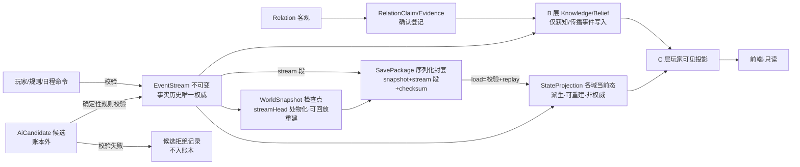
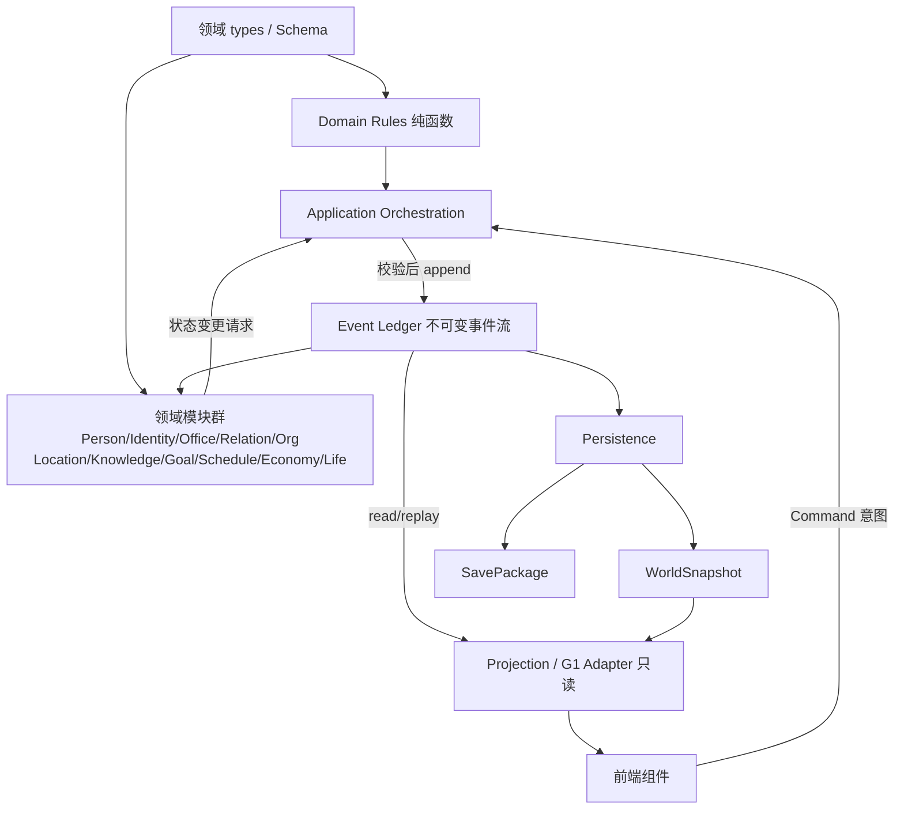

# 正式世界领域模型与边界契约草案 v0.1

> **项目：**《观远》古代官员与官场社会模拟器
> **文档状态：** 候选草案 / **02-R2 最终语义收口版 · 待最终审查 · 未冻结**
> **基线：** `feat/g1-engine@93b984e`（v0.16 总纲已合入）；R2 修订基线 `c812320`
> **权威关系：** 服从根目录《设计总纲.md》v0.16 与两份专项规范；**v0.16 是设计权威，本草案不得反向修改**；冲突以总纲为准。
> **性质：** 只读审计 + 设计契约。**不含任何运行时代码改动**；Schema 为草案文本，不写入 app/；无法定稿的类型显式标待决，不伪装完整可编译。

---

## 1. 设计目标与适用范围

### 1.1 目标

为正式世界运行时（W1 人物领域 → W2 生命周期 → W3 事件账本 → W4 存档迁移 → W5 G1 适配）提供领域模型与边界契约；02-R2 完成最终语义收口：关系四分、存储权威链、一对多日程、Office 空缺语义、Event 判别联合、引用类型补齐、Asset 权利主体、五域权威拆清、ID 作用域与并发、逐领域依赖矩阵、W1/W3 测试分离。

### 1.2 适用范围

适用：正式世界运行时领域层、W1–W5 契约依据。不适用：M1 预览切片运行逻辑（W5 适配）、前端重构、v0.16 冻结原则修改。七人河工＝中期任官压力测试夹具，非正式开局人物库。

### 1.3 核心裁决继承（v0.16，R2 重申保留）

1. Person 跨场景/跨时间/跨人生阶段持续存在；死亡不删除历史。
2. 年龄＝derive(worldTime, birth)，禁止存储矛盾年龄字段。
3. Identity / Office / Role / Status 不混淆；Office 独立于人物、岗位可空缺、职权随岗位。
4. Relation 有向、多重、可不对称；债务/职位/组织成员/共同知情不自动推导私人信任。
5. A 客观事实 / B 人物认知 / C 玩家可见严格隔离；Projection 不得写入事实。
6. AI 只生成候选；未经确定性规则校验不得成为事实。
7. **EventStream 是事实历史唯一权威**；快照/投影/存档包皆派生。
8. 世界不围着玩家转；NPC 按 L0–L3 分层。
9. 未决设计标待裁决，不得擅自冻结。

## 2. 现有代码审计结果（基线 93b984e，逐文件实读）

### 2.1 领域对象真实映射表

| 对象 | 当前定义 | 使用位置 | 所有者 | 持久化 | 事件驱动 | 重复 | 事实/认知混合 | 复用结论 |
|---|---|---|---|---|---|---|---|---|
| Person | types.ts:72-99 | data.ts:10 静态七人；各面板只读 | data.ts（运行时零写入） | 否 | 否 | 无 | tokens/claim/questions 混合 | 适配领域 Person；静态降夹具 |
| RelationTokens | types.ts:28-32 | DebtLedger/PersonArchive 只读 | data.ts | 否 | 否（无写入路径） | 与 Debt/Hook 三合一 | 混合 | 废弃权威；拆 Relation/Debt/Hook |
| Goal | types.ts:64-70 | data.goals＋state.goalId | data.ts＋state | goalId 入存档 | 否 | 与 NPC Goal 同名异义 | 玩家≠人物 | PlayerGoal 保留；NPC Goal 新建 |
| WorldEvent / GeneratedEvent | schedule.ts:10-20 / narrative/types.ts:80-87 | engine/commands/narrative | schedule＋state＋叙事档 | 部分 | 部分 | 继承重叠 | present 字符串 | 账本化 Event；Generated 降 AiCandidate |
| Clue / Comparison | types.ts:37-43/56-62 | state；EvidenceBoard | useGame | 入存档 | 是 | 无 | 玩家单层 | C 层调查产物 |
| RevealDepth | types.ts:9＋people.ts:41 | 认知闸 | 纯投影 | 否 | 间接 | 无 | 仅玩家层 | C 层谓词重基 |
| RiverPlan | types.ts:45-54 | state.plan | useGame | 入存档 | 是 | 无 | 玩家委托 | Task/Commission（W3/W5） |
| Body/Mind/Capability/Identity/Relation/Debt/Secret/Hook/Knowledge/Belief/Location/Schedule/Asset/Org/Membership | 全库无定义 | — | — | — | — | — | — | 新建（W1/W2/W3） |
| LifeHistory | 无；milestones＋sharedHistoryOf | PersonArchive/Epilogue | data＋投影 | 否 | 否 | 无 | 混合 | 事件引用序（W2） |
| Office/Authorization | 无；power.ts:76 投影 | PowerLedger | 纯投影 | 否 | 间接 | 无 | 无官职实体 | 新建 Office（可空缺） |

### 2.2 写入路径与权威现状

useGame 13 处 setState＋save.v1 无版本→前端为权威（违原则 9，W5 退壳）；commands 校验→成本→原子→rejected 模式保留（W3 接 Ledger）；handledEvents 仅 id 列表＋pendingEvent 单槽→W3 账本化；四持久化 key（save/narrative/narrative.secret/prefs.read）；tokens 无运行时写入、claim 静态→W1 迁 Knowledge。

### 2.3 重复与冲突结论

Goal 同名异义禁合并；RelationTokens 三合一拆分；WorldEvent/GeneratedEvent 继承重叠→统一 Event＋AiCandidate 来源语义；Clue/RevealDepth 单层→B 层新建；无第二套 Person/Event/Relation；本草案不建平行系统。

## 3. 领域实体总表

### 3.1 实体与权威

| 实体 | 层 | 权威所有者 | 变更途径 | 持久化 | M1 |
|---|---|---|---|---|---|
| Person | 核心 | Person 模块 | 仅 Event | 是 | 骨架＋夹具 |
| IdentityAssignment | 身份 | Identity 模块 | 仅 Event | 是 | 三轴骨架 |
| Role / Status | 身份 | 投影 | 仅 Event 间接 | 投影 | 当前态 |
| Office / Authorization | 身份 | Office 模块 | 仅 Event | 是 | 夹具官职·可空缺 |
| Relation | 关系 | Relation 模块 | 仅 Event | 是 | 类型化骨架 |
| RelationClaim / RelationEvidence | 关系确认 | Relation 模块（确认登记） | 仅 Event | 是 | 骨架 |
| Organization / Membership | 关系 | Organization 模块 | 仅 Event | 是 | 骨架 |
| Location | 位置 | Location 模块 | 仅 Event | 是 | 场景级 |
| KnowledgeEntry / Belief / Message | 认知 | Knowledge 模块 | 仅获知/传播事件 | 是 | B 层骨架 |
| Goal / PlayerGoal | 目标 | Goal 模块 | 仅 Event | 是 | 骨架 |
| ScheduleEntry（多人物多条） | 日程 | Schedule 模块 | 仅 Event | 是 | 日/时段级 |
| Asset / Debt | 经济 | Economy 模块 | 仅 Event | 是 | 四权骨架 |
| Body / Mind | 生命 | Life 模块（两独立 scope） | 仅 Event（W2） | 是 | 留接口 |
| Capability | 能力 | Person 模块 | 仅 Event（W2 成长） | 是 | 夹具五维 |
| LifeHistory | 生命 | Life 模块 | 追加不覆盖 | 是 | W2 |
| AiCandidate | 候选 | Narrative（账本外） | 校验前不入账本 | 叙事档 | 候选边界 |
| Event / EventStream | 事实 | Event Ledger | 唯一写入 | 是 | W3 |
| WorldSnapshot / SavePackage | 存储派生 | Persistence | 序列化/迁移 | 是 | W4 |
| Projection / G1 Adapter | 投影 | Adapter | 只读零写入 | 否 | W5 |

### 3.2 v0.16 全人物状态域映射表（R2 更新）

| v0.16 状态域 | 领域实体/模块 | 阶段 | M1 | 现 G1 对应 |
|---|---|---|---|---|
| 身体 | Body（Life 模块·物理 scope） | W2 | 留接口 | 无 |
| 心理 | Mind（Life 模块·心理 scope，独立于 Body） | W2 | 留接口 | Person.fear 静态 |
| 能力 | Capability（Person 模块） | W1 骨架/W2 成长 | 夹具五维 | Capability/needs |
| 教育知识 | Knowledge＋Identity(social) | W1/W3 | 骨架 | 无 |
| 身份资格 | IdentityAssignment＋Office | W1 | 夹具 | seal/rank/origin |
| 人生阶段 | LifeState＋WorldTime 推导 | W2 | 留接口 | 无 |
| 家庭亲属 | Relation(kinship)＋Identity(family) | W1/W2 | 骨架 | 无 |
| 关系 | Relation＋RelationClaim/Evidence＋KnowledgeEntry | W1/W3 | 骨架 | tokens 静态 |
| 组织 | Organization/Membership | W1 | 骨架 | 无 |
| 经济 | Asset(四权)/Debt | W1/W3 | 骨架 | privateFunds/ledgerRows |
| 认知 | Knowledge/Belief/Message | W1/W3 | B 骨架 | Clue/RevealDepth |
| 目标计划 | Goal/PlayerGoal | W1 | 骨架 | goals＋goalId |
| 日程位置 | ScheduleEntry(一对多)/Location | W1/W2 | 场景级 | presence/fixedEvents |
| 名声评价 | Relation 强度投影＋echoes | W3/W5 | 投影 | reputation/echoesOf |
| 法律风险 | Office/Authorization＋越权 Event | W3 | 投影 | overreachOf |
| 物品生活 | Asset(kind=物品) | W2+ | 留接口 | 无 |

## 4. Person 核心模型

```ts
type PersonId = string & { readonly __brand: 'PersonId' }
interface Person {
  id: PersonId                       // 世界内稳定唯一，跨时间持续
  displayName: string
  birth: Field<WorldTime>
  lifeState: 'alive' | 'dead'
  archiveState: 'active' | 'archived'   // 与 lifeState 独立
  death: Field<DeathRecord>
  capability: CapabilityRef             // Person 模块权威（R2 拆清）
  stateDomains: {
    body: BodyScopeRef                  // Life 模块·物理
    mind: MindScopeRef                  // Life 模块·心理（独立 scope）
    knowledge: KnowledgeScopeId         // Knowledge 模块
    goals: GoalId[]
    scheduleScope: ScheduleScopeId      // 一对多：scope 下多条 ScheduleEntry（R2 修正 3）
    economy: EconomyScopeId
    location: LocationStateRef
  }
  history: LifeHistoryRef
  fixture: Field<'m1-river-seven'>
}
interface DeathRecord { at: WorldTime; causeEvent: EventId; estateSettlements: EstateSettlementRef[] }
interface EstateSettlementRef { domain: 'office' | 'debt' | 'asset' | 'membership' | 'relation' | 'goal'; settlementEvent: EventId; status: 'pending' | 'settled' }
```

边界：生命态/归档态独立；身后结算六域独立链；死亡/归档不删 Person 与 History；场景卸载只卸投影；年龄单源；身份多重留历史；四类不自动推导信任；关系不对称；三态哨兵见 §11.1。
**Person↔Schedule 一对多（R2 修正 3）**：Person 持 scheduleScope（集合引用），ScheduleEntry.person 回指 PersonId；一个 Person 多条 ScheduleEntry（跨日/跨时段/跨地点），禁止单 ScheduleId 字段。

## 5. 身份、职务与状态边界

```ts
interface IdentityAssignment { id: IdentityId; person: PersonId; axis: 'institutional' | 'social' | 'family' | 'organizational'; code: string; validFrom: EventId; validTo: EventId | 'open'; sourceEvent: EventId; visibility: Visibility; certainty: Certainty }
type HolderState =
  | { kind: 'held'; person: PersonId }   // 在任
  | { kind: 'vacant' }                   // 明确空缺：岗位设立但无任职人（R2 修正 4）
  | { kind: 'unknown' }                  // 任职人存在但不可知（与 vacant 严格区分）
interface Office { id: OfficeId; institution: OrgId; rank: string; title: string; holder: HolderState; authorization: AuthorizationBundle; validFrom: EventId; validTo: EventId | 'open' }
interface Appointment { id: EventId; office: OfficeId; person: PersonId; from: WorldTime; to: Field<WorldTime> }
type Role = Projection<IdentityAssignment[], Membership[]>
type Status = Projection<LifeState, IdentityAssignment[], Office[]>
```

Identity≠Office≠Role≠Status；Office 独立、可空缺、职权随岗（v0.16 人物与职位分离，Q12 推荐保持独立、禁合并）；vacant≠unknown：vacant 是制度事实（A 层），unknown 是认知缺口（B/C 层语义）；entitlementsOf 保留为 Authorization 投影（W5 重基）。

## 6. Relation 与 Organization（R2 修正 1：四分）

```ts
interface Relation {                      // 客观关系（A 层事实）
  id: RelationId; from: PersonId; to: PersonId
  type: RelationType                      // 枚举待决 Q11
  lifecycle: { status: 'active' | 'dormant' | 'severed'; validFrom: EventId; validTo: EventId | 'open' }
  sourceEvent: EventId; visibility: Visibility
}
interface RelationClaim {                 // 关系事实的确认登记（A 层元数据，非认知）
  id: RelationClaimId; relation: RelationId
  claimant: PersonId | 'player'
  certainty: Certainty                    // confirmed/reported/suspected/unverified
  assertedAt: WorldTime; sourceEvent: EventId
}
interface RelationEvidence {              // 支撑 claim 的证据引用
  id: RelationEvidenceId; claim: RelationClaimId
  evidence: EntityRef; weight: 'direct' | 'corroborating' | 'hearsay'
  sourceEvent: EventId
}
// 人物对关系的认知＝B 层 KnowledgeEntry(subject=RelationId)，独立于上述三者
interface Organization { id: OrgId; type: string; name: string; purpose: string; region: string; rules: RuleRef[] }
interface Membership { id: MembershipId; org: OrgId; person: PersonId; role: string; obligations: string[]; validFrom: EventId; validTo: EventId | 'open'; sourceEvent: EventId }
```

四分边界：客观 Relation（成立/休眠/断绝）／RelationClaim+Evidence（事实被确认到何种程度、凭何证据）／KnowledgeEntry（每个 holder 知道/误信/不知）／C 层玩家视图（再过滤）。claim 的 certainty 不改变客观 lifecycle；Knowledge 不改变 claim；同两人多条 Relation、有向、不对称；Membership 不自动产生 Relation；tokens 拆 Debt/Hook/强度投影（Q5）。

## 7. Location、Knowledge 与 Belief

```ts
interface LocationState { person: PersonId; place: PlaceId; movement: 'settled' | 'traveling' | 'unknown'; since: EventId; route: Field<RouteRef> }
type Stance = 'known' | 'believed' | 'suspected' | 'misunderstood'
interface KnowledgeEntry { id: KnowledgeId; holder: PersonId; subject: EntityRef; proposition: string; stance: Stance; sourceEvent: EventId; acquiredAt: WorldTime; secrecy: 'public' | 'private' | 'secret' }
type Belief = KnowledgeEntry & { stance: 'believed' | 'misunderstood' }
interface Message { id: MessageId; sender: PersonId; recipient: PersonId; channel: ChannelRef; contentRefs: EntityRef[]; sentAt: WorldTime; deliveredAt: Field<WorldTime>; readAt: Field<WorldTime>; repliedAt: Field<WorldTime>; failure: Field<FailureKind>; distortion: number; parentMessage: Field<MessageId> }
```

边界：Knowledge 按 holder 隔离；Belief 为 stance 子集（type 别名）；Message 接收四段＋failure 独立；送达事件才写 recipient Knowledge；传播链 parentMessage＋distortion；位置认知独立于位置事实；presence/revealDepth 降 C 层投影。

## 8. Goal、Schedule、Asset 与 Debt

```ts
interface Goal { id: GoalId; person: PersonId; statement: string; priority: number; status: 'active' | 'achieved' | 'abandoned' | 'failed'; sourceEvent: EventId; visibility: Visibility }
interface PlayerGoal { id: 'player'; aspirationCode: string; statement: string; chosenAt: WorldTime }
interface ScheduleScope { id: ScheduleScopeId; person: PersonId }        // 一对多集合（R2 修正 3）
interface ScheduleEntry { id: ScheduleId; scope: ScheduleScopeId; person: PersonId; day: WorldDay; period: Period; action: ActionRef; place: PlaceId; intent: 'planned'; execution: Field<EventId>; deviation: Field<EventId>; visibility: Visibility }
interface RightGrant {                    // R2 修正 7：权利主体＋授权边界
  holder: PersonId | OrgId                // 权利主体（人或组织）
  grantedBy: EventId                      // 授权来源事件
  scope: string                           // 权利范围描述
  revocable: boolean; transferable: boolean
  expires: Field<WorldTime>
}
interface Asset {
  id: AssetId; owner: Field<PersonId>; kind: string; quantity: number
  rights: { ownership: RightGrant; control: RightGrant; handling: RightGrant; disposal: RightGrant }
  custody: Field<PersonId>; valuation: Field<number>
}
interface Debt { id: DebtId; creditor: PersonId; debtor: PersonId; principal: number; kind: string; sourceEvent: EventId; status: 'open' | 'settled' | 'disputed'; settlements: EventId[] }
```

Asset 四权边界：ownership=归属主体；control=支配/管理主体（可非 owner）；handling=经手/保管主体（≠disposal）；disposal=处分主体（须 ownership 或显式 disposal 授权）；每权独立 holder/grantedBy/scope/revocable/transferable/expires；授权与撤销走事件；owner 死亡不删资产（遗产链）；Schedule＝planned intent，execution/deviation 以事件引用；Visibility observer-scoped 且 C 层再经 B 闸。

## 9. 三层信息隔离

| 层 | 内容 | 所有者 | 写入 | 读取 |
|---|---|---|---|---|
| A 客观事实 | 出生/任职/债务/送达/死亡/关系成立 | EventStream＋领域状态 | 仅 Event | 规则、B/C 源 |
| B 人物认知 | 知道/误信/不知 | Knowledge（holder scope） | 仅获知/传播事件 | NPC、C 过滤源 |
| C 玩家可见 | 亲眼/文书/交谈/调查 | Projection/Adapter | 只读零写入 | 前端 |

硬规则：A 不因玩家不知而不存在；B 按 holder 隔离；C 过滤 B/A；AI 候选不得写事实；C 非第二权威；三态哨兵贯穿。

### 9.1 事实、认知、投影、事件流、状态快照、存档包关系图（R2 更新）



权威链（R2 修正 2）：**EventStream 唯一权威** → StateProjection 派生当前态 → WorldSnapshot＝streamHead 处检查点（缓存）→ SavePackage＝序列化封套（snapshot＋stream 段＋schemaVersion＋checksum），load 时校验 checksum 并以 replay 重建/补段；**Projection 与 Snapshot 均非权威、不得反写**；W3/W4 存储实现不锁定（仅 append/read/replay/checkpoint/migrate 接口）。

## 10. ID 与引用规则

### 10.1 ID 作用域、并发与重试（R2 修正 9）

- **世界作用域**：所有实体 id 在 WorldId 命名空间内唯一；跨世界 id 不可比较/不可复用；SavePackage 携带 worldId＋saveId，存档间引用不跨世界。
- **并发分配**：Event Ledger 单写者串行 append；实体 id 由领域模块在 commit 时经 ledger 单调序分配（base32），**禁止客户端预分配事件 id**；并发请求由 ledger 序列化，无锁竞争语义外泄。
- **clientRequestId 重试稳定**：客户端每意图生成一次 UUID，重试复用同 id；IdempotencyKey＝hash(source,intentKind,actor,requestWorldTime,clientRequestId)，提交前计算、不依赖 seq；同 key 重试→duplicate 返回原 eventId；新意图→新 clientRequestId。
- 前缀范围：p-/e-/id-/of-/rel-/rcl-/rev-/org-/mem-/kn-/msg-/goal-/sch-/ssc-/ast-/dbt-/loc-/cand-；id 永不复用/变更；归档/死亡不回收。
- 引用一律 by-id；WorldTime＝{day,period} 单调、不与真实时间耦合；历法 epoch 待决 Q2；validFrom/validTo＝EventId|'open'；年龄/时长 derive。

### 10.2 提交结果契约

```ts
type CommitResult =
  | { status: 'committed'; event: Event }
  | { status: 'duplicate'; eventId: EventId }
  | { status: 'rejected'; reason: string }
```

## 11. Schema 草案（强类型文本，不入 app/）

### 11.1 三态哨兵与基础类型

```ts
type Absent = { kind: 'unknown' } | { kind: 'not-generated' } | { kind: 'n/a' }
type Field<T> = { kind: 'value'; value: T } | Absent   // 禁 null/缺省；空集合=已知为空
type WorldTime = { day: number; period: '晨' | '午' | '暮' | '夜' }
type WorldDay = number
type Certainty = 'confirmed' | 'reported' | 'suspected' | 'unverified'
type Visibility = { observer: PersonId | 'player'; level: 'public' | 'contact' | 'private' | 'secret' }
```

### 11.2 核心引用类型（R2 修正 6：补齐；待决显式标记）

```ts
type WorldId = string & { readonly __brand: 'WorldId' }
type SaveId = string & { readonly __brand: 'SaveId' }
type EventId = string & { readonly __brand: 'EventId' }
type IdentityId = string & { readonly __brand: 'IdentityId' }
type OfficeId = string & { readonly __brand: 'OfficeId' }
type RelationId = string & { readonly __brand: 'RelationId' }
type RelationClaimId = string & { readonly __brand: 'RelationClaimId' }
type RelationEvidenceId = string & { readonly __brand: 'RelationEvidenceId' }
type OrgId = string & { readonly __brand: 'OrgId' }
type MembershipId = string & { readonly __brand: 'MembershipId' }
type KnowledgeId = string & { readonly __brand: 'KnowledgeId' }
type KnowledgeScopeId = string & { readonly __brand: 'KnowledgeScopeId' }
type MessageId = string & { readonly __brand: 'MessageId' }
type GoalId = string & { readonly __brand: 'GoalId' }
type ScheduleId = string & { readonly __brand: 'ScheduleId' }
type ScheduleScopeId = string & { readonly __brand: 'ScheduleScopeId' }
type AssetId = string & { readonly __brand: 'AssetId' }
type DebtId = string & { readonly __brand: 'DebtId' }
type LocationStateRef = string & { readonly __brand: 'LocationStateRef' }
type PlaceId = string & { readonly __brand: 'PlaceId' }
type BodyScopeRef = string & { readonly __brand: 'BodyScopeRef' }
type MindScopeRef = string & { readonly __brand: 'MindScopeRef' }
type CapabilityRef = string & { readonly __brand: 'CapabilityRef' }
type EconomyScopeId = string & { readonly __brand: 'EconomyScopeId' }
type LifeHistoryRef = string & { readonly __brand: 'LifeHistoryRef' }
type CandidateId = string & { readonly __brand: 'CandidateId' }
type CommandRef = string & { readonly __brand: 'CommandRef' }
type FailureKind = 'lost' | 'refused' | 'intercepted' | 'delayed'   // 待决 Q15：渠道失败枚举随 ChannelRef 定稿
type ChannelRef = string & { readonly __brand: 'ChannelRef' }     // 待决 Q15：通信渠道枚举（M1 面呈/书信）
type RouteRef = string & { readonly __brand: 'RouteRef' }         // 待决 Q14：路线 schema（M2 舆图）
type ActionRef = string & { readonly __brand: 'ActionRef' }       // 待决 Q16：行动目录绑定（八动词主干）
type RuleRef = string & { readonly __brand: 'RuleRef' }           // 待决 Q13：规则目录机器绑定格式
type RelationType = string                                        // 待决 Q11：枚举冻结清单
type EntityRef =
  | { kind: 'person'; id: PersonId } | { kind: 'relation'; id: RelationId }
  | { kind: 'claim'; id: RelationClaimId } | { kind: 'office'; id: OfficeId }
  | { kind: 'org'; id: OrgId } | { kind: 'asset'; id: AssetId }
  | { kind: 'debt'; id: DebtId } | { kind: 'event'; id: EventId }
  | { kind: 'knowledge'; id: KnowledgeId } | { kind: 'message'; id: MessageId }
```

### 11.3 候选 / Event 判别联合 / 快照 / 存档包（R2 修正 2/5）

```ts
interface AiCandidate { id: CandidateId; provider: string; model: string; intent: string; proposed: ProposedEvent[]; state: 'pending' | 'validated' | 'rejected'; rejectionReason: Field<string>; validatedBy: RuleRef[] }
interface ProposedEvent { kind: string; participants: PersonId[]; refs: EntityRef[]; payload: Record<string, unknown> }
interface EventBase { id: EventId; idempotencyKey: string; at: WorldTime; kind: string; participants: PersonId[]; refs: EntityRef[]; payload: Record<string, unknown>; visibility: Visibility[]; causedBy: Field<EventId> }
type Event =
  | (EventBase & { source: 'rule'; candidateRef?: never })
  | (EventBase & { source: 'player-command'; candidateRef?: never; command: CommandRef })
  | (EventBase & { source: 'ai-candidate'; candidateRef: CandidateId })   // 必填，与 source 匹配
  | (EventBase & { source: 'schedule'; candidateRef?: never; scheduleEntry: ScheduleId })
interface WorldSnapshot { schemaVersion: number; worldId: WorldId; streamHead: EventId; checkpointAt: WorldTime; materialized: MaterializedState }
interface SavePackage { saveId: SaveId; worldId: WorldId; schemaVersion: number; streamRange: { from: EventId; to: EventId }; snapshot: WorldSnapshot; checksum: string; createdAt: WorldTime }
type MaterializedState = { persons: Person[]; identities: IdentityAssignment[]; offices: Office[]; relations: Relation[]; claims: RelationClaim[]; evidence: RelationEvidence[]; orgs: Organization[]; memberships: Membership[]; locations: LocationState[]; knowledge: KnowledgeEntry[]; messages: Message[]; goals: Goal[]; playerGoal: PlayerGoal | null; schedules: ScheduleEntry[]; assets: Asset[]; debts: Debt[] }
```

- Event 判别联合保证 source↔candidateRef 匹配：ai-candidate 必带 candidateRef，其余 source 以 `candidateRef?: never` 禁止携带。
- AiCandidate 账本外；未校验不入账本；拒绝留候选日志。
- EventStream/StateProjection/WorldSnapshot/SavePackage 权威与序列化关系见 §9.1；MaterializedState 可由 replay 重建；存储实现不锁定。
- 待决类型（Q11/Q13/Q14/Q15/Q16）显式标记，**不伪装完整可编译定稿**。

## 12. 模块依赖矩阵

### 12.1 逐领域模块依赖矩阵（R2 修正 10）

| 模块 | 拥有权威 | 依赖（读） | 可写 | 禁止 |
|---|---|---|---|---|
| Person | Person 本体＋Capability | types | 仅经 Event | 写 Identity/Relation/Knowledge |
| Identity | IdentityAssignment | Person(读) | 仅经 Event | 写 Office/Relation |
| Office | Office/Authorization | Identity/Org(读) | 仅经 Event | 写 Person/Relation；职权随人 |
| Relation | Relation＋Claim/Evidence | Person/Identity(读) | 仅经 Event | 写 Knowledge；由 Office/Debt/Membership/共同知情自动建边 |
| Organization | Org/Membership | Person(读) | 仅经 Event | 自动建 Relation |
| Location | LocationState | Person/Schedule(读) | 仅经 Event | 写 Knowledge |
| Knowledge | Knowledge/Belief/Message | Relation/Location/Event(读) | 仅获知/传播 Event | 写 A 层事实 |
| Goal | Goal/PlayerGoal | Person(读) | 仅经 Event | 写 Relation |
| Schedule | ScheduleScope/Entry | Person/Location(读) | 仅经 Event | 写事实（execution 只引用 Event） |
| Economy | Asset/Debt | Person/Org(读) | 仅经 Event | 写 Relation |
| Life | Body/Mind/LifeHistory | Person(读) | 仅经 Event（W2） | W1 实现；写 Identity |
| Event Ledger | EventStream | types/Rules | 唯一 append | 依赖 UI/存储实现 |
| Persistence | Snapshot/SavePackage/迁移 | Ledger 接口 | 序列化/迁移 | 含业务规则 |
| Projection/Adapter | 无 | Ledger 读＋Snapshot | 零 | 任何写入 |
| Application Orchestration | 用例 | Rules＋Ledger 接口 | 经 append | 直接改领域状态 |
| Domain Rules | 判定 | types | 否 | import 上层 |

### 12.2 领域模块—应用编排—事件存储—投影依赖图（R2 更新，与 §12.1 一致）



单向：types→rules→orchestration→ledger→persistence→snapshot/savepackage→projection→UI；领域模块只经 Event 间接交互、禁止同层互写；UI 仅 Command 意图入编排；Projection 零写入；Rules 不反向依赖。

## 13. 现有代码复用与迁移建议

| 现有 | 结论 | 迁移 |
|---|---|---|
| commands 校验→成本→原子→rejected | 复用模式 | W3 接 Ledger；CommitResult 三态 |
| commandFeedback | 复用 | 增 duplicate 分支 |
| engine 纯函数/幂等/advanceDay | 复用风格 | W2 重基 WorldTime |
| handledEvents | 复用思路 | W3 IdempotencyKey 前置 |
| narrative schema/白名单/候选 | 复用 | AiCandidate→校验→Event |
| presence/revealDepth/personPresenceOf | 适配 | C 层投影 W5 重基 |
| power entitlementsOf/echoesOf/impressionsOf | 适配 | Authorization/回声投影 |
| data 七人/goals/ledgerRows/fixedEvents | 降夹具 | W1 契约样本 |
| tokens/claim/questions 静态 | 废弃权威 | W1 拆 Relation/Debt/Hook/Knowledge |
| useGame React+localStorage | 废弃权威 | W5 退壳；W4 版本化 |
| pendingEvent 单槽 | 废弃 | W3 待决队列＝账本投影 |
| Clue/Comparison | 适配 | C 层调查产物 |
| engine-test/smoke/check:docs/CI | 复用 | W1 契约测试＋W3 集成测试分离 |

## 14. 待裁决问题（候选方案＋影响＋裁决人；未冻结）

| # | 问题 | 候选（★推荐） | 影响 | 裁决人 |
|---|---|---|---|---|
| Q1 | 夹具 slug 与 p-id 共存 | ★双向映射表／双 id | W1 ID/夹具 | 项目负责人 |
| Q2 | 年龄粒度与历法 | ★年粒度＋worldDay／日粒度；epoch 另定 | W2 | 项目负责人 |
| Q3 | M1 死亡/身后链范围 | ★骨架＋单域示例／六域全链 | W2/W3 | 项目负责人 |
| Q4 | NPC LOD 落地层 | ★M1 L0/L1／全层 | W2 成本 | 项目负责人 |
| Q5 | tokens 拆分时机 | ★W1 骨架＋W3 接事件／W3 一次拆 | W1/W3 | 项目负责人 |
| Q6 | schemaVersion 落地阶段 | ★W1 定规则＋W4 迁移／W4 引入 | W4 | 项目负责人 |
| Q7 | PlayerGoal 命名 | ★PlayerGoal／Aspiration | 命名 | 项目负责人 |
| Q8 | claim 迁 Knowledge 时机 | ★W1／W3 | W1/W3 | 项目负责人 |
| Q9 | RevealDepth 四档 | ★保留 C 层离散档／连续可见度 | C 层 | 项目负责人 |
| Q10 | M1 AI 新人物许可 | ★禁止（仅夹具）／受控生成 | v0.15 落地 | 项目负责人 |
| Q11 | RelationType 枚举 | ★十类基础枚举／扩展 | W1 关系 | 项目负责人 |
| Q12 | Office 与 Identity 边界 | ★**Office 独立**（人物与职位分离，禁合并）／合并（不推荐） | W1 实体/职权 | 项目负责人 |
| Q13 | RuleRef 机器绑定格式 | ★规则目录 id 引用／内嵌条款 hash | W3 校验 | 项目负责人 |
| Q14 | RouteRef schema | ★M2 舆图节点路段／M1 占位 | W2/M2 | 项目负责人 |
| Q15 | ChannelRef/FailureKind 枚举 | ★面呈/书信/托传＋lost/refused/intercepted/delayed／扩展 | W3 通信 | 项目负责人 |
| Q16 | ActionRef 行动目录绑定 | ★八动词主干 id／扩展目录 | W3 编排 | 项目负责人 |

## 15. W1 最小实现建议（R2 修正 11：W1/W3 测试分离）

**W1 基础契约测试（纯函数，无 Ledger/无运行时集成）**：
1. Schema/Field 哨兵：禁 null/缺省、空集合=已知为空、三态判别。
2. ID 规则：世界作用域唯一、永不复用、前缀范围、clientRequestId 重试稳定（同 id 重试→同 key）。
3. 年龄单源推导；身份历史不覆盖；Office vacant≠unknown；Person↔Schedule 一对多。
4. 关系四分：客观 lifecycle／claim certainty／Knowledge holder／C 过滤互不反写；不对称/多重/无来源不成立。
5. 五域权威拆清：Body/Mind/Capability/Identity/Relation 跨域只读、禁互写。
6. Asset 四权主体/授权边界；Event 判别联合 source↔candidateRef 匹配（类型级测试）。
7. 三层隔离静态约束：Projection 零写入、Rules 不反向依赖（依赖矩阵 lint）。

**W3 事件账本集成测试（接 Ledger 后）**：commit/duplicate/rejected 语义、幂等键前置、replay 重建 snapshot、SavePackage checksum＋补段、投影失效、AiCandidate 校验管线、待决队列投影。

W1 不接运行时；预计 2 道施工令（types+校验+契约测试 / 夹具映射+投影接口）。

## 16. W2–W5 接口预留

- W2：LifeHistory 追加、Body/Mind 事件钩子、年龄/衰老/疾病/死亡/六域身后结算 kind。
- W3：Ledger.commit/replay/幂等/投影失效；AiCandidate 校验管线；待决队列。
- W4：Persistence.migrate＋回滚＋完整性；SavePackage 校验/补段；存储选型此阶段裁定。
- W5：Adapter.read(scope)→C 投影；useGame 退壳；组件改读 Adapter。

## 17. 验收标准

1. 17 章完整；R2 十一项修正落实；§9.1/§12.2 图与 §12.1 矩阵/§3.2 映射表图文一致。
2. 审计引用真实（93b984e）；无平行系统；EventStream 唯一权威；Projection 零写入。
3. TS 示例语义自洽：判别联合/Field/引用类型补齐；待决类型显式标记不伪装定稿；无矛盾字段约束。
4. W1 基础契约测试与 W3 集成测试边界清晰（§15）。
5. check:docs / test:engine / build / smoke(独立端口) / diff --check 全通过；app/ 与 .github/ 零差异。
6. README 标候选/未冻结（不得标已批准）；待决含候选/影响/裁决人。
7. 原则全保留（§1.3）；v0.16 不被反向修改。

---

*本草案为 W1 领域契约候选稿（02-R2 最终语义收口版）；冻结须项目负责人最终审查。整改完成后停止，不进入 W1 运行时施工。*