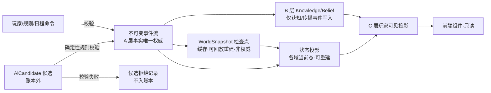
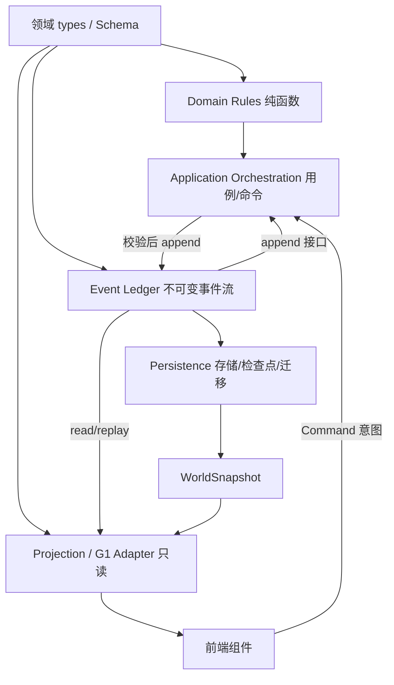

# 正式世界领域模型与边界契约草案 v0.1

> **项目：**《观远》古代官员与官场社会模拟器
> **文档状态：** 候选草案 / **02-R1 语义修正版 · 待第二轮裁决**（未冻结）
> **基线：** `feat/g1-engine@93b984e992e0db7e4d227c0fc954346b3f9c2b60`（v0.16 总纲已合入）；R1 修订基线 `31d0f22`
> **权威关系：** 服从根目录《设计总纲.md》v0.16、《世界生命与自由人生模拟系统设计规范-v0.1》、《人物分类与社会关系网络系统设计规范-v0.1》。与总纲冲突时以总纲为准。
> **性质：** 只读审计 + 设计契约。**不含任何运行时代码改动**；Schema 为草案文本，不写入 app/。

---

## 1. 设计目标与适用范围

### 1.1 目标

为正式世界运行时（W1 人物领域 → W2 生命周期 → W3 事件账本 → W4 存档迁移 → W5 G1 适配）提供第一份领域模型与边界契约，回答施工令 02 的七个问题，并按 02-R1 修正事件幂等、AI 候选、快照权威、生命状态、三态语义、关系认知与模块依赖。

### 1.2 适用范围

- 适用：正式世界运行时领域层设计、W1–W5 施工令契约依据。
- 不适用：M1 河工七人预览切片运行逻辑（W5 才适配）；前端页面重构；v0.16 已冻结原则的修改。
- 七人河工样本＝中期任官压力测试夹具，**不是正式开局人物库**；仅作 W1 契约测试样本。

### 1.3 核心裁决继承（v0.16，R1 重申保留）

1. Person 是跨场景/跨时间/跨人生阶段持续存在的个体；死亡不删除历史。
2. 年龄由出生时间与世界时间推导，禁止重复维护矛盾年龄字段。
3. Identity / Office / Role / Status 不得混为一谈；**人物与职位分离**（Office 可空缺，职权随岗位不随人）。
4. 关系有方向、可多重、可不对称；职务/债务/组织成员/共同知情不自动推导私人信任。
5. A 客观事实 / B 人物认知 / C 玩家可见严格隔离；前端投影不得成为第二权威。
6. AI 只生成候选；事实必须经确定性规则校验与事件提交。
7. 世界不围着玩家转；NPC 按 L0–L3 分层模拟。
8. 所有未决设计标待裁决，不得擅自冻结。

## 2. 现有代码审计结果（基线 93b984e，逐文件实读）

### 2.1 领域对象真实映射表

| 对象 | 当前定义 | 实际使用位置 | 数据所有者 | 持久化 | 事件驱动 | 重复定义 | 事实/认知混合 | 复用结论 |
|---|---|---|---|---|---|---|---|---|
| Person | `src/types.ts:72-99` | `data.ts:10` 静态七人；PersonPanel/PersonArchive/Sections/DebtLedger/GrowthPreview 只读 | data.ts 作者常量（运行时零写入） | 否 | 否 | 无第二 Person | 混合：tokens/claim/questions 静态挂人物 | 适配为领域 Person；静态表降为夹具样本 |
| RelationTokens | `types.ts:28-32`（owesYou/hook/youOwe） | data.ts 静态；DebtLedger/PersonArchive/PersonPanel 只读 | data.ts | 否 | 否（全库无运行时写入） | 与 Debt/Hook 三合一 | 混合 | 废弃为权威；拆 Relation/Debt/Hook |
| Goal | `types.ts:64-70` | data.ts:3 目录；Overlays.GoalPrologue；state.goalId | data.ts＋state.goalId | goalId 入存档 | 否 | 与 NPC Goal 同名异义 | 玩家志向≠人物目标 | 保留为 PlayerGoal；NPC Goal 新建 |
| WorldEvent | `schedule.ts:10-20` | schedule.ts:21 五条 authored；engine.resolveWorldOptionPure；pendingEvent 单槽 | schedule.ts＋state | handledEvents/pendingEvent 入存档 | 部分 | 与 GeneratedEvent 继承重叠 | present 字符串无参与者结构 | 适配为 Event 账本条目（W3） |
| GeneratedEvent | `narrative/types.ts:80-87` | schema 校验→effects→commands.executeGenerated | narrative store＋handledEvents | 叙事档独立 key | 是 | 继承重叠 | effect 只选目录 id（边界正确） | 保留候选边界；改 AiCandidate→校验→账本 |
| Clue / Comparison | `types.ts:37-43 / 56-62` | state.clues/comparisons；EvidenceBoard/IntelligenceDrawer | useGame state | 入存档 | 是 | 无 | 玩家单层 | 归 C 层玩家调查产物 |
| RevealDepth | `types.ts:9`＋`people.ts:41` | 认知闸投影 | 纯投影 | 否 | 间接 | 无 | 仅玩家层 | 保留为 C 层谓词，W1 重基 Knowledge |
| RiverPlan | `types.ts:45-54` | state.plan；evaluateRiverTask | useGame state | 入存档 | 是 | 无 | 玩家委托 | 适配 Task/Commission（W3/W5） |
| Body/Exposure/Relation/Debt/Secret/Hook/Knowledge/Belief/Location/Schedule/Asset/Organization/Membership/Identity | 全库 grep 无定义 | — | — | — | — | — | — | 全部新建（W1/W2/W3） |
| LifeHistory | 无实体；milestones 静态＋sharedHistoryOf 推导 | PersonArchive/EpilogueCard | data.ts＋投影 | 否 | 否 | 无 | 混合 | 新建＝事件引用序（W2） |
| Location / Schedule | 无实体；presence.ts 当值表＋fixedEvents 公开日历 | personPresenceOf/十日时钟 | 常量 | 否 | 间接 | 无 | 仅投影 | 新建实体；现表降为投影源 |
| Asset / Debt | 无实体；privateFunds/material/giftEntries/ledgerRows | HUD/账房/DebtLedger | state＋data.ts | 部分 | 部分 | 无 | 玩家资产与人物债混合 | 新建 Asset/Debt（权属分离） |
| Office / Authorization | 无实体；power.ts:76 entitlementsOf 投影 | PowerLedger/OfficialReview | 纯投影 | 否 | 间接 | 无 | 投影正确但无官职实体 | 新建 Office（人物与职位分离）；entitlementsOf 保留投影 |

### 2.2 写入路径与权威现状

- `useGame.ts` 13 处 setState；世界权威＝React state＋`guanyuan.save.v1`（无 schema 版本）→ 违反原则 9，W5 退壳。
- `commands.ts` 校验→成本→原子→rejected 模式保留；W3 接 Event Ledger，CommandResult 扩展 status（§10.3）。
- 幂等现状 handledEvents 仅 id 列表、pendingEvent 单槽 → W3 账本化＋幂等键前置（§10.2）。
- 持久化四 key：save.v1 / narrative.v1 / narrative.secret.v1 / prefs.read.v1；会话内存 viewMemory/reviewTrail/folioEcho/placeTrail 不入存档（正确）。
- 关系冻结证据：tokens 全库无运行时写入；口供静态证据：Person.claim 为作者常量、asked 命中即显示 → W1 迁 Knowledge。

### 2.3 重复与冲突检查结论

1. Goal 同名异义 → 禁止合并（Q7）。
2. RelationTokens 三合一 → 拆分（Q5）。
3. WorldEvent/GeneratedEvent 继承重叠 → 账本化统一 Event，Generated 降为 AiCandidate 来源语义，非平行系统。
4. Clue/RevealDepth 单层认知 → B 层新建。
5. 无第二套 Person/Event/Relation 运行时系统；本草案不新建平行系统。

## 3. 领域实体总表

### 3.1 实体与权威

| 实体 | 层 | 权威所有者 | 变更途径 | 持久化 | M1 范围 |
|---|---|---|---|---|---|
| Person | 核心 | Person 模块 | 仅 Event | 是 | 骨架＋夹具七人 |
| IdentityAssignment | 身份 | Identity 模块 | 仅 Event | 是 | 三轴骨架 |
| Role / Status | 身份 | 投影（Identity＋Membership＋LifeState） | 仅 Event 间接 | 投影 | 当前态 |
| Office / Authorization | 身份 | Office 模块 | 仅 Event（任免） | 是 | 夹具官职；**可空缺** |
| Relation | 关系 | Relation 模块 | 仅 Event | 是 | 类型化骨架 |
| Organization / Membership | 关系 | Organization 模块 | 仅 Event | 是 | 骨架 |
| Location | 位置 | Location 模块 | 仅 Event | 是 | 场景级 |
| Knowledge / Belief / Message | 认知 | Knowledge 模块（每人物 scope） | 仅获知/传播事件 | 是 | B 层骨架 |
| Goal / PlayerGoal | 目标 | Goal 模块 | 仅 Event | 是 | NPC 骨架＋玩家志向 |
| Schedule | 日程 | Schedule 模块 | 仅 Event | 是 | 日/时段级 |
| Asset / Debt | 经济 | Economy 模块 | 仅 Event | 是 | 权属分离骨架 |
| Body / LifeState | 生命 | Life 模块 | 仅 Event（W2） | 是 | W1 留接口 |
| LifeHistory | 生命 | Life 模块 | 追加不覆盖 | 是 | W2 |
| AiCandidate | 候选 | Narrative 模块（**账本外**） | 校验前不得入账本 | 叙事档 | 候选边界 |
| Event（账本） | 事实 | Event Ledger | 唯一写入入口 | 是 | W3 |
| Persistence | 存储 | Persistence 模块 | 序列化/迁移 | 是 | W4 |
| Projection / G1 Adapter | 投影 | Adapter | **只读零写入** | 否 | W5 |

### 3.2 v0.16 全人物状态域映射表（完整映射，暂不要求全部实现）

| v0.16 状态域 | 领域实体/模块 | 实现阶段 | M1 范围 | 现 G1 对应物 |
|---|---|---|---|---|
| 身体（健康/疲劳/疾病/恢复） | Body/LifeState | W2 | 留接口 | 无 |
| 心理（情绪/压力/恐惧） | Body/LifeState＋Knowledge | W2 | 留接口 | Person.fear 静态 |
| 能力（五维/称号/成长） | Person.capability＋Identity | W1 骨架/W2 成长 | 夹具五维 | Capability/needs |
| 教育知识 | Knowledge＋Identity(social 轴) | W1/W3 | 骨架 | 无 |
| 身份资格（科举/出身/品级） | IdentityAssignment＋Office | W1 | 夹具 | Person.seal/rank/origin |
| 人生阶段 | LifeState＋WorldTime 推导 | W2 | 留接口 | 无 |
| 家庭亲属 | Relation(kinship)＋Identity(family 轴) | W1 骨架/W2 代际 | 骨架 | 无 |
| 关系 | Relation | W1/W3 | 类型化骨架 | RelationTokens 静态 |
| 组织 | Organization/Membership | W1 骨架 | 骨架 | 无 |
| 经济 | Asset/Debt | W1 骨架/W3 | 权属分离 | privateFunds/ledgerRows |
| 认知 | Knowledge/Belief/Message | W1/W3 | B 层骨架 | Clue/RevealDepth 单层 |
| 目标计划 | Goal/PlayerGoal | W1 | 骨架 | data.goals＋goalId |
| 日程位置 | Schedule/Location | W1/W2 | 场景级 | presence/fixedEvents |
| 名声评价 | Relation 强度投影＋echoes | W3/W5 | 投影 | reputation/echoesOf |
| 法律风险 | Office/Authorization＋Event(越权) | W3 | 投影 | overreachOf |
| 物品生活 | Asset(kind=物品) | W2+ | 留接口 | 无 |

## 4. Person 核心模型

```ts
type PersonId = string & { readonly __brand: 'PersonId' }
interface Person {
  id: PersonId                      // 稳定唯一，跨场景/时间/人生阶段不变
  displayName: string
  birth: Field<WorldTime>           // 未知用哨兵，不用 null
  lifeState: 'alive' | 'dead'       // 生命状态（生物/法律意义）
  archiveState: 'active' | 'archived'  // 归档状态（记录管理），与 lifeState 独立
  death: Field<DeathRecord>         // 死亡记录；未死={kind:'n/a'}
  stateDomains: {
    body: BodyStateRef              // W2
    knowledge: KnowledgeScopeId     // B 层归属
    goals: GoalId[]
    schedule: ScheduleId
    economy: EconomyScopeId
    location: LocationStateRef
  }
  history: LifeHistoryRef           // 事件引用序；死亡/归档不删除
  fixture: Field<'m1-river-seven'>  // 夹具标记；正式人物={kind:'n/a'}
}
interface DeathRecord { at: WorldTime; causeEvent: EventId; estateSettlements: EstateSettlementRef[] }
interface EstateSettlementRef { domain: 'office' | 'debt' | 'asset' | 'membership' | 'relation' | 'goal'; settlementEvent: EventId; status: 'pending' | 'settled' }
```

边界裁决（R1 修正 4）：
1. **生命态与归档态分离**：lifeState=dead 不自动 archived；archived 是记录管理动作（可独立于死亡发生，如离任归档），二者独立字段、独立事件。
2. **身后结算分域独立**：死亡事件触发各域独立结算链——Office 空缺事件、Debt 继承/清偿事件、Asset 遗产转移事件、Membership 终止事件、Relation 丧偶/状态事件、Goal 未竟承诺事件；每域自有 settlementEvent 与 status，**不合并为单一「身后处理」标志**。
3. 死亡不删除 Person 与 LifeHistory；场景卸载只卸载投影。
4. 年龄单源：age=derive(worldTime, birth)；birth 未知→年龄 unknown；禁止存储年龄。
5. 身份多重留历史；职务/债务/组织成员/共同知情不自动推导私人信任；关系不对称。
6. 三态哨兵见 §11.1（判别联合，禁 null/缺省/空集合混用）。

## 5. 身份、职务与状态边界

```ts
interface IdentityAssignment {
  id: IdentityId; person: PersonId
  axis: 'institutional' | 'social' | 'family' | 'organizational'
  code: string
  validFrom: EventId; validTo: EventId | 'open'
  sourceEvent: EventId; visibility: Visibility; certainty: Certainty
}
interface Office {
  id: OfficeId                      // 法定岗位实体，独立于人物（v0.16 人物与职位分离）
  institution: OrgId; rank: string; title: string
  holder: Field<PersonId>           // 可空缺={kind:'unknown'} 或 {kind:'n/a'}（岗位未设人）
  authorization: AuthorizationBundle   // 职权随岗位，不随人
  validFrom: EventId; validTo: EventId | 'open'
}
interface Appointment { id: EventId; office: OfficeId; person: PersonId; from: WorldTime; to: Field<WorldTime> }
type Role = Projection<IdentityAssignment[], Membership[]>
type Status = Projection<LifeState, IdentityAssignment[], Office[]>
```

- Identity≠Office≠Role≠Status（R1 重申）：Identity=「是谁」多轴有历史；Office=法定岗位＋职权（**可空缺、任免事件驱动、职权随岗位**）；Role=场景/组织内功能（投影）；Status=此刻状态（投影）。
- **Q12 推荐：Office 保持独立实体，不得并入 IdentityAssignment 的 institutional 轴**（v0.16 人物与职位分离；合并会丢失空缺岗位与职权随岗语义）。最终裁决留项目负责人。
- 现 Person.role/rank/status 降为夹具显示字段；power.ts entitlementsOf 保留为 Authorization 投影（W5 重基），不得反向写 Office。

## 6. Relation 与 Organization

```ts
interface Relation {
  id: RelationId; from: PersonId; to: PersonId
  type: RelationType                // 枚举待裁决 Q11
  lifecycle: { status: 'active' | 'dormant' | 'severed'; validFrom: EventId; validTo: EventId | 'open' }  // 客观生命周期
  certainty: Certainty              // 关系事实的确认程度（A 层元数据）
  sourceEvent: EventId              // 必填：无来源事件不得成立
  visibility: Visibility
}
// 人物对关系的认知＝B 层独立 KnowledgeEntry（subject=RelationId），不内嵌于 Relation
interface Organization { id: OrgId; type: string; name: string; purpose: string; region: string; rules: RuleRef[] }
interface Membership { id: MembershipId; org: OrgId; person: PersonId; role: string; obligations: string[]; validFrom: EventId; validTo: EventId | 'open'; sourceEvent: EventId }
```

R1 修正 7（三分离）：
1. **客观生命周期**（lifecycle）：关系成立/休眠/断绝的事实状态，由事件驱动。
2. **事实确认程度**（certainty）：该关系事实本身被确认到何种程度（confirmed/reported/suspected/unverified），属 A 层元数据，与生命周期独立（关系可 active 但 certainty=suspected）。
3. **人物对关系的认知**（B 层）：每个 holder 独立的 KnowledgeEntry（知道/误信/不知该关系），与客观 lifecycle/certainty 独立；玩家视图（C 层）再按 holder=player 过滤。
- 同两人多条 Relation 并存、有向、不对称；不压好感总分；Membership 不自动产生 Relation。
- RelationTokens 废弃为权威：owesYou/youOwe→Debt；hook→Hook（Secret 子类）；人情计数→Relation 强度投影（Q5）。

## 7. Location、Knowledge 与 Belief

```ts
interface LocationState { person: PersonId; place: PlaceId; movement: 'settled' | 'traveling' | 'unknown'; since: EventId; route: Field<RouteRef> }
type Stance = 'known' | 'believed' | 'suspected' | 'misunderstood'
interface KnowledgeEntry {
  id: KnowledgeId; holder: PersonId          // B 层每人物独立 scope
  subject: EntityRef; proposition: string
  stance: Stance
  sourceEvent: EventId; acquiredAt: WorldTime
  secrecy: 'public' | 'private' | 'secret'
}
type Belief = KnowledgeEntry & { stance: 'believed' | 'misunderstood' }   // R1 修正 6：type 别名，非 interface 赋值
interface Message {
  id: MessageId; sender: PersonId; recipient: PersonId
  channel: ChannelRef; contentRefs: EntityRef[]
  sentAt: WorldTime
  deliveredAt: Field<WorldTime>   // 送达≠已阅≠同意
  readAt: Field<WorldTime>
  repliedAt: Field<WorldTime>
  failure: Field<FailureKind>
  distortion: number              // 传播失真度
  parentMessage: Field<MessageId> // 传播链
}
```

R1 修正 8（边界补齐）：
- Knowledge=holder 对 subject 的认知条目（含 known/suspected）；Belief=stance 为 believed/misunderstood 的子集（类型别名，不另立存储）。
- 消息传播＝Message 链（parentMessage＋distortion）；**接收状态四段独立**（sent/delivered/read/replied）＋failure；送达事件才写 recipient 的 KnowledgeEntry，未送达不写；误信由 distortion/误解事件产生 misunderstood 条目。
- NPC 不自动知他人秘密：KnowledgeEntry 仅由获知/传播事件写入；位置认知独立于位置事实（A/B/C 三层各自）。
- presence.ts 降为 C 层在场投影；revealDepthOf 重基为 C 层谓词；Clue/Comparison 归 C 层。

## 8. Goal、Schedule、Asset 与 Debt

```ts
interface Goal { id: GoalId; person: PersonId; statement: string; priority: number; status: 'active' | 'achieved' | 'abandoned' | 'failed'; sourceEvent: EventId; visibility: Visibility }
interface PlayerGoal { id: 'player'; aspirationCode: string; statement: string; chosenAt: WorldTime }
interface ScheduleEntry {
  id: ScheduleId; person: PersonId; day: WorldDay; period: Period
  action: ActionRef; place: PlaceId
  intent: 'planned'               // 日程是计划意图，不是事实
  execution: Field<EventId>       // 执行产生 Event；未执行={kind:'unknown'}
  deviation: Field<EventId>       // 偏差/缺席产生偏差事件
  visibility: Visibility
}
interface Asset {
  id: AssetId; owner: Field<PersonId>   // 遗产期 owner 可为 deceased 引用，不删除
  kind: string; quantity: number
  rights: { ownership: boolean; control: boolean; handling: boolean; disposal: boolean }
  custody: Field<PersonId>        // 经手/保管与所有分离
  valuation: Field<number>        // 估值与数量分离
}
interface Debt { id: DebtId; creditor: PersonId; debtor: PersonId; principal: number; kind: string; sourceEvent: EventId; status: 'open' | 'settled' | 'disputed'; settlements: EventId[] }
```

R1 修正 10 语义补充：
- Office：法定岗位独立、可空缺、职权随岗（§5）。
- Asset：四权分离＋custody/valuation 独立；owner 死亡不删除资产（遗产链）。
- Schedule：planned intent≠fact；execution/deviation 以事件引用表达；私有日程对玩家不可见。
- Visibility：observer-scoped（public/contact/private/secret）；是 A 层元数据，C 层过滤须再经 B/Knowledge 闸（可见性≠已获知）。
- Goal/PlayerGoal 命名待裁决 Q7；Debt 不自动推导恩怨。

## 9. 三层信息隔离

| 层 | 内容 | 所有者 | 写入途径 | 读取者 |
|---|---|---|---|---|
| A 客观世界事实 | 出生/任职/债务成立/送达/死亡 | Event Ledger＋领域状态 | 仅 Event 提交（规则校验后） | 规则引擎、B/C 投影源 |
| B 人物认知与信念 | 甲知道/乙误信/丙不知 | Knowledge（每人物 scope） | 仅获知/传播事件 | NPC 决策、C 过滤源 |
| C 玩家可见信息 | 亲眼/文书/交谈/调查所得 | Projection/Adapter | **只读零写入** | 前端组件 |

硬规则：A 不因玩家不知而不存在；B 按 holder 隔离；C 过滤 B/A；AI 候选不得把猜测写成事实；C 非第二权威；三态哨兵贯穿三层。

### 9.1 事实、认知、投影、事件流、状态快照关系图（R1 新增）



- 不可变事件流＝事实唯一权威；状态投影＝派生当前态（可重建、非权威）；WorldSnapshot＝序列化检查点（缓存，replay 可重建，**非第二权威**）；三者分离（R1 修正 3）。
- W3/W4 存储实现（文件/SQLite/IndexedDB/索引结构）**不在本草案锁定**，仅定接口（append/read/replay/checkpoint/migrate）。

## 10. ID 与引用规则

### 10.1 ID 范围与稳定性

- 前缀范围：p-（Person）/e-（Event）/id-（Identity）/of-（Office）/rel-（Relation）/org-/mem-/kn-/msg-/goal-/sch-/ast-/dbt-/loc-/cand-（AiCandidate）。
- 夹具保留现稳定 slug（xiancheng/zhubu/expert/foreman/liangshang/gentry＋player）；正式生成 `p-<base32 单调序>`；**id 永不复用、永不变更**；归档/死亡不回收 id。
- 引用一律 by-id，禁止内嵌对象副本。

### 10.2 Event ID 与幂等键（R1 修正 1）

- EventId＝`e-<base32 单调序>`，**提交时分配**；账本位置 seq 为存储元数据，**不属于 Event 身份字段**。
- IdempotencyKey＝hash(source, intentKind, actor, requestWorldTime, clientRequestId)，**提交前计算，不依赖分配后的 seq/EventId**。
- 重复提交语义：同 IdempotencyKey → 返回 `{status:'duplicate', eventId:原事件}`，**不重复应用、状态不变**；UI 提示「已入卷」而非新成功。不同 key 即使内容相同→新事件（内容哈希不入 key，除非 intent 声明确定性）。
- 时间字段：WorldTime＝{day, period}；历法 epoch 待裁决 Q2（夹具 day1＝到任日；正式历法另定）；WorldTime 单调、不与真实时间耦合。
- 有效期：validFrom/validTo＝EventId 或 'open'；年龄/时长一律 derive。
- 删除/失效/死亡/归档：不物理删除；失效=validTo 事件；死亡=lifeState 事件＋分域身后链；归档=archiveState 事件。

### 10.3 提交结果契约

```ts
type CommitResult =
  | { status: 'committed'; event: Event }
  | { status: 'duplicate'; eventId: EventId }
  | { status: 'rejected'; reason: string }
```

## 11. Schema 草案（强类型文本，不入 app/）

### 11.1 三态哨兵（R1 修正 5：无歧义判别联合）

```ts
type Absent =
  | { kind: 'unknown' }        // 存在但不可知
  | { kind: 'not-generated' }  // 世界尚未生成
  | { kind: 'n/a' }            // 不适用
type Field<T> = { kind: 'value'; value: T } | Absent
// 禁止 null；禁止缺省键（Schema 校验要求显式 Field）；
// 空集合={kind:'value', value:[]} 表示「已知为空」，与 unknown 严格区分。
type WorldTime = { day: number; period: '晨' | '午' | '暮' | '夜' }
type Certainty = 'confirmed' | 'reported' | 'suspected' | 'unverified'
type Visibility = { observer: PersonId | 'player'; level: 'public' | 'contact' | 'private' | 'secret' }
```

### 11.2 候选、事件、快照分离（R1 修正 2/3）

```ts
interface AiCandidate {
  id: CandidateId; provider: string; model: string; intent: string
  proposed: ProposedEvent[]                 // 候选提案，非事实
  state: 'pending' | 'validated' | 'rejected'
  rejectionReason: Field<string>
  validatedBy: RuleRef[]                    // 通过的确定性规则
}
interface Event {
  id: EventId; idempotencyKey: string; at: WorldTime
  source: 'rule' | 'player-command' | 'ai-candidate' | 'schedule'   // 来源=已提交事件的出处字段
  candidateRef: Field<CandidateId>          // source=ai-candidate 时必填引用
  kind: string; participants: PersonId[]; refs: EntityRef[]
  payload: Record<string, unknown>
  visibility: Visibility[]; causedBy: Field<EventId>
}
interface WorldSnapshot {
  schemaVersion: number                     // 落地阶段待裁决 Q6
  streamHead: EventId; checkpointAt: WorldTime
  materialized: MaterializedState           // 可由 replay(events) 重建
}
// EventStream（不可变）/ StateProjection（派生）/ WorldSnapshot（检查点）三者分离；
// 存储实现不锁定（W3/W4 仅接口）。
```

- AiCandidate 存叙事档（账本外）；**未经规则校验不得进入账本**；拒绝记录留候选日志，不入 EventStream。
- Event.source 是已提交事件的出处；候选≠事件≠来源三者分离。
- 融合审查：WorldSnapshot 为唯一世界序列化结构；现 GameState 映射见 §13；禁止平行 Person/Event/Relation。

## 12. 模块依赖矩阵

### 12.1 权威与读写

| 模块 | 拥有权威 | 可读 | 可提交变更 | 仅投影 | 禁止依赖 |
|---|---|---|---|---|---|
| Domain Rules（纯函数） | 规则判定 | 领域 types | 否（只判定） | — | 禁止 import 编排/账本/存储/投影/UI |
| Application Orchestration | 用例编排 | Rules＋Ledger 接口 | 经 Ledger append | — | 禁止直接改领域状态 |
| Event Ledger | 不可变事件流 | 全模块只读 | **唯一写入入口** | — | 禁止依赖 UI/存储实现 |
| Persistence | 序列化/迁移 | Ledger 接口 | 迁移脚本 | — | 禁止含业务规则 |
| Projection / G1 Adapter | 无 | Ledger 读＋Snapshot | **零** | 全部 UI 数据 | 禁止任何写入 |
| 前端组件 | 无 | Projection | 仅提交 Command 意图 | — | 禁止直接写领域 |

### 12.2 领域模块—应用编排—事件存储—投影依赖图（R1 新增）



- 单向：types → rules → orchestration → ledger → persistence → snapshot → projection → UI；UI 仅经 Command 意图进入 orchestration，**不得直接写领域**。
- 防循环：同层领域模块间只经 Event 间接交互，禁止同层互写；Rules 不反向依赖任何上层；Projection 零写入。
- 前端组件禁止成为领域写入者（原则 9）。

## 13. 现有代码复用与迁移建议

| 现有 | 结论 | 迁移路径 |
|---|---|---|
| commands.ts 校验→成本→原子→rejected | 复用模式 | W3 接 Ledger；CommitResult 扩 status（§10.3） |
| commandFeedback.ts | 复用 | 增加 duplicate 分支提示 |
| engine.ts 纯函数/幂等/advanceDay | 复用风格 | W2 重基 WorldTime；advanceDay 降适配器 |
| handledEvents 幂等 | 复用思路 | W3 升级 IdempotencyKey 前置 |
| narrative schema/白名单/候选边界 | 复用 | AiCandidate→校验→Event(source=ai-candidate) |
| presence/revealDepthOf/personPresenceOf | 适配 | C 层投影，W5 重基 |
| power.ts entitlementsOf/echoesOf/impressionsOf | 适配 | Authorization/回声投影，W5 重基 |
| data.ts 七人/goals/ledgerRows/fixedEvents | 降为夹具 | W1 契约测试样本 |
| Person.tokens/claim/questions 静态 | 废弃为权威 | W1 拆 Relation/Debt/Hook/Knowledge |
| useGame React+localStorage 权威 | 废弃为权威 | W5 退壳；W4 版本化 |
| pendingEvent 单槽 | 废弃 | W3 待决队列＝账本投影 |
| Clue/Comparison | 适配 | C 层玩家调查产物 |
| engine-test/smoke/check:docs/CI | 复用 | W1 增契约测试 |

## 14. 待裁决问题（候选方案＋影响范围＋裁决人；未冻结）

| # | 问题 | 候选方案（★=推荐） | 影响范围 | 待裁决人 |
|---|---|---|---|---|
| Q1 | 夹具 slug 与正式 p-id 共存 | ★映射表（夹具 slug↔p-id 双向表）／双 id 字段 | W1 ID 规则、夹具映射 | 项目负责人 |
| Q2 | 年龄粒度与历法 | ★年粒度＋worldDay 推导／日粒度；历法 epoch 另定 | W2 年龄/生命周期 | 项目负责人 |
| Q3 | M1 死亡/身后链范围 | ★M1 仅骨架＋单域示例／全六域身后链 | W2/W3 范围 | 项目负责人 |
| Q4 | NPC LOD 落地层 | ★M1 仅 L0/L1／L0–L3 全层 | W2 模拟成本 | 项目负责人 |
| Q5 | RelationTokens 拆分时机 | ★W1 拆骨架＋W3 接事件／W3 一次拆 | W1/W3 工作量 | 项目负责人 |
| Q6 | schemaVersion 落地阶段 | ★W1 定规则＋W4 落地迁移／W4 才引入 | W4 迁移责任 | 项目负责人 |
| Q7 | PlayerGoal 命名 | ★PlayerGoal／Aspiration | 命名一致性 | 项目负责人 |
| Q8 | claim 迁 Knowledge 时机 | ★W1 迁／W3 随账本迁 | W1/W3 | 项目负责人 |
| Q9 | RevealDepth 四档保留 | ★保留为 C 层离散档／改连续可见度 | C 层投影 | 项目负责人 |
| Q10 | M1 AI 新人物生成许可 | ★M1 禁止（仅夹具）／许可受控生成 | v0.15 空白开局落地 | 项目负责人 |
| Q11 | RelationType 枚举 | ★亲属/姻亲/师生/同年/同僚/上下级/恩主门生/政敌/合作/债务衍生／扩展枚举 | W1 关系骨架 | 项目负责人 |
| Q12 | Office 与 IdentityAssignment 边界 | ★**保持 Office 独立**（v0.16 人物与职位分离；禁合并）／合并入 institutional 轴（不推荐） | W1 实体数、职权语义 | 项目负责人 |

## 15. W1 最小实现建议

1. 领域 types＋Schema 校验器（纯函数无 React）：§11 全实体骨架＋Field 哨兵＋ID 规则＋CommitResult。
2. 契约测试：ID 稳定/唯一、幂等键前置与 duplicate 语义、年龄单源、身份历史不覆盖、关系三分离与不对称、三层隔离（A 独立于 C、B 按 holder、C 零写入）、哨兵非 null/空集合语义、候选未校验不入账本、快照可回放重建。
3. 夹具映射表：七人→Person/Identity/Office/Relation/Debt 样本（只读）。
4. **不接运行时**；W5 才适配。预计 2 道施工令。

## 16. W2–W5 接口预留

- W2：LifeHistory 追加、Body/LifeState 事件钩子、年龄/衰老/疾病/死亡/分域身后结算事件 kind。
- W3：Ledger.commit(event)→校验→append→投影失效；IdempotencyKey；replay(events)→snapshot；AiCandidate 校验管线。
- W4：Persistence.migrate(snapshot, from, to)＋失败回滚＋完整性校验；存储实现选型在此阶段裁定。
- W5：Adapter.read(scope)→C 层投影；useGame 退壳；组件改读 Adapter。

## 17. 验收标准

1. 17 章结构完整；R1 十一项修正落实；三新增件（§9.1 关系图、§12.2 依赖图、§3.2 状态域映射表）在位。
2. 审计引用真实文件:行号（基线 93b984e）；重复/冲突结论明确；无平行系统。
3. 新增类型示例语法正确（type 别名/判别联合），无相互矛盾字段约束（null/缺省/空集合语义统一于 Field）。
4. `npm run check:docs`、`npm run test:engine`、`npm run build`、`node scripts/smoke.mjs`（独立端口）、`git diff --check` 全通过；app/ 与 .github/ 零差异。
5. README 索引状态同步；待决项含候选方案/影响/裁决人，未伪装冻结。
6. 原则保留：Person 持续/死亡不删历史/年龄单源/四概念不混/关系有向多重不对称/不自动推导/三层隔离/AI 候选/投影非权威/七人夹具。

---

*本草案为 W1 领域契约候选稿（02-R1 语义修正版）；冻结须项目负责人第二轮裁决。整改完成后停止，不实现 W1 运行时代码。*